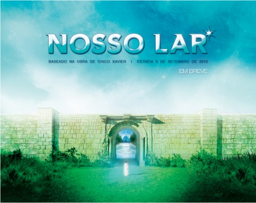

# Filme: Nosso Lar

Nosso Lar é uma produção brasileira e trata de um tema atemporal e bastante evidente em nosso dia a dia: a vida (após a morte). Poderia dizer a morte, mas como no próprio filme, direi apenas encarnação e desencarnação uma vez que a morte é apenas uma etapa cumprida no plano terrestre.

O filme conta a história de André Luiz, um médico do início do século XX que após viver uma vida desregrada, cheia de excessos e sem tempo para a família desencarna e "acorda" no Umbral. O Umbral, segundo o espiritismo, é um plano onde os desencarnados "acordam" logo após a morte (caso esteja dando uma definição equivocada, por favor, corrijam-me). Como em uma história contada em primeira pessoa, o espírito de André Luiz narra sua própria jornada até um plano espiritual onde encontra vários espíritos irmãos e reencontra o espírito de sua mãe, que lhe ajudam a compreender sua nova condição. Este processo de entendimento faz parte da depuração do espírito de André Luiz para encarar novos aprendizados, passar por novas experiências e expiações. André Luiz, em sua narrativa, nos conta com muita sensibilidade como é a vida no plano da colônia espiritual de "Nosso Lar" e como foi sua experiência até chegar lá.

Esta é uma história "verídica" que foi ditada pelo espírito de André Luiz e psicografada pelo médium brasileiro Chico Xavier. Esta obra psicografada pode ser encontrada [neste livro](http://www.sej.org.br/livros/lar_br.pdf) (277 p., o download é público). Comecei a ler o livro há duas semanas e a narrativa descritiva é muito rica. Mas aviso que esta não deve ser apenas uma leitura curiosa: deve-se aproveitar o momento para reflexão sobre as suas próprias atitudes, como forma de autoconhecimento e renovação espiritual.

[Assistir ao vídeo no YouTube](http://www.youtube.com/watch?v=3EcOGAxYPHo&fs=1&hl=pt_BR&rel=0&border=1)

e compreende sua nova condição.
