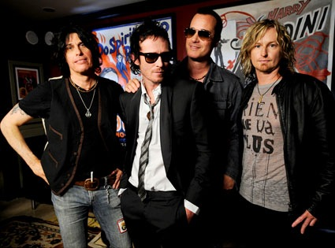

# Playlist: Stone Temple Pilots

 Provavelmente os Stone Temple Pilots são a banda de quem mais gosto atualmente. Não porque escuto suas músicas com muita frequência, mas porque sempre os escuto é como se fosse a primeira vez: há sempre um detalhe, uma nova canção que descubro/percebo. Os caras estão na estrada desde 1988 e desde aquela época a música deles é incomparável, têm um estilo de cantar e tocar muito originais que, na minha opinião, os fazem a grande banda que são. Acho que a primeira música que ouvi deles foi "Big Bang Baby" (do albúm Tiny Music... Songs from the Vatican Gift Shop), e me lembro de como passava na MTV. Zapeando pelos canais na televisão, inevitavelmente parava por alguns instantes para ouvir aquela música, cuja banda não importava muito… Alguns anos depois, meu ouvido musical já estava um pouco mais amadurecido e seleto, e foi quando surgiu a canção "Creep" (do albúm Core) e mais tarde "Down" (do albúm No. 4). Incrível, até hoje ouço os riffs pesados desta música aliados aos vocais incomparáveis de Scott Weiland, com imenso vigor.

Depois do album No. 4 fui procurar a discografia da banda, e tudo o que encontrei foram músicas cada vez mais incríveis, melodias com solos desconsertantes e as vocalizações feitas com um megafone de Scott Weiland.

<http://www.youtube.com/view_play_list?p=68BE9028B6FFC26A>
