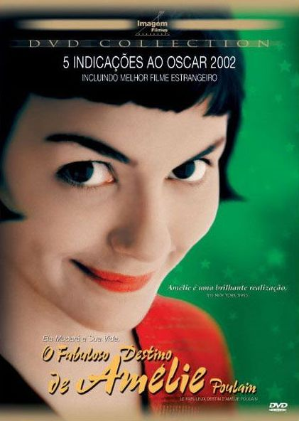

# Filme: O Fabuloso destino de Amélie Poulain

O Fabuloso destino de Amélie Polain é um daqueles filmes diferentes que você assiste raramente, quando não sobram mais filmes americanos nas prateleiras das locadoras para assistir. É também daqueles filmes que geralmente passam na seção coruja e nunca na seção da tarde, é daqueles que você compra nas Americanas por 12,90 reaus. E como todo filme desse tipo, é bom pacas.

Eu acho que todo cinema que não é (ou que não pretende ser) americano (ou hollywoodiano) é bom, e só por isso já merece uma olhada pelo menos na sinopse. Claro que há bons filmes americanos, mas não estou falando daqueles filmes sem pé nem cabeça que não tem boa fotografia etc. Estou falando de filmes com um orçamento, talvez, menor do que os americanos mas que tem um bom enredo, uma boa história para contar. São sempre assim, e o Fabuloso destino de Amélie Poulain é tão bom pela história, quanto pela fotografia (se bem que os cenários franceses são sempre bonitos) e - na minha modesta opinião, tão bom pela trilha sonora do virtuoso instrumentista, compositor etc [Yann Tiersen](http://pt.wikipedia.org/wiki/Yann_Tiersen).

Na história, Amélie é uma garota francesa tímida e retraída que trabalha num café nos arredores de Paris. Amélie passa sua vida observando as pessoas e vive em seu mundinho fechado onde encontra-se consigo mesma. As pessoas que fazem parte de sua vida tem vidas normais e com problemas normais. Amélie convive pacientemente com tudo e com todos, mas o amor, este sempre lhe pareceu distante. Amélie, diante das exentricidades de alguns de seus convivas, resolve redefinir o rumo de sua história quando encontra uma pessoa com a qual lhe parece ser possível partilhar a vida. E nesta busca, Amélie descobre o amor de uma pessoa tão diferente - e tão igual, a ela mesma. E o resto você assiste e comenta aqui.

Acho que o mais interessante desta história, é que as características de Amélie são tão bem desenhadas que é possível enxergar várias pessoas que conheço e até algumas características minhas. Me considero uma pessoa normal - dentro dos padrões atuais de convivência humana :P, e esta história mostra isso, mas nos mostra também o quão frágeis e fortes somos, o quão distraídos, expertos e tímidos somos. Se você não consegue se enxergar num espelho e dizer quem você é, pergunte para a Amélie ;)

Excelente filme!

 

[Assistir ao vídeo no YouTube](http://www.youtube.com/watch?v=kjH6mOILViA&fs=1&hl=en_US&rel=0)
