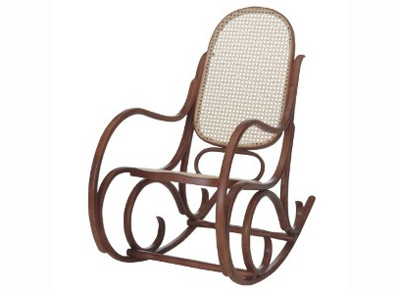

# Balanço de Outubro

Pois bem, mais um mês na vida, menos um mês no ano. Outubro passou e nem percebi, muito trabalho, pouco tempo para pensar na vida. Pensar na vida é importante, ajuda a organizar as idéias, a colocar as coisas no seu devido lugar. Sem mais delongas, vamos ao balanço deste mês:

Curso de modelagem: neste mês de outubro, participei do [III Worketa](http://cursos.cptec.inpe.br/worketa/), um curso/workshop introdutório sobre modelagem atmosférica com o modelo [Eta](http://www.emc.ncep.noaa.gov/mmb/wrkstn_eta/) ministrado pelo grupo de modelagem de mesoescala do [CPTEC](http://www.cptec.inpe.br/). Foi uma semana muito intensa, aprendemos a instalar o modelo (versão de tempo e clima), a rodar e analisar os resultados. Foi bastante interessante ver que hoje em dia é possível rodar um modelo de mesoescala (não-hidrostático) com 5 km em um laptop! Consegui fazer 48 horas de previsão em um Core i3 (2 núcleos físicos + 2 em hyper-threating) em apenas 3 horas!! Claro que não fizemos [assimilação de dados](http://assimila.cptec.inpe.br/), o que tornaria o problema extremamente custoso, mas foi uma experiência muito bacana. Eu já conhecia o modelo Eta, pois o utilizei em minha dissertação de mestrado em assimilação de dados (e neste caso não seria possível rodar esta versão em um notebook), mas o curso me sanou várias dúvidas sobre alguns aspectos do modelo. Em modelagem, sempre há muito, muito a se aprender.

Ônibus para o trabalho: acho que saímos perdendo no trabalho... agora estamos à pé. Sacanagem.

A Luta da Honra Contra o Tempo: o Marco Aurélio postou neste mês em seu blog, um post com o título "[Dm (ou ré menor)](http://aureliomasr.blogspot.com/2010/10/dm-ou-re-menor.html)" que fala sobre a nossa música "A Luta da Honra Contra o Tempo". Vale a pena ler o post dele, que para mim foi bastante nostálgico. Ano que vem, esta nossa música vai completar dez anos! Incrível como o tempo passa rápido! Dá até medo!!

Eleições: este foi o mês em que tivemos o 1º e o 2º turno de nossas eleições nacionais para deputados, governadores e presidente. Achei uma falta de respeito com o eleitor toda a palhaçada que fizeram na televisão, tudo o que eu via era ou a Dilma denegrindo a imagem do Serra ou o contrário. Sem comentário. Tudo isso torna o pleito vergonhoso de se participar.

No CraftMind: no blog, escrevi bastante para os meus padrões! Neste mês escrevi os seguintes poemas/poesias: Cidades, Chegada, Ilusório, Recomeçar, Silêncio, Dilemas e Instante. Todos meus poemas/poesias podem ser lidos [aqui](http://craftmind.wordpress.com/poemaspoesias/). Das músicas, foram as seguintes: Lembranças e Estação. Todas as minhas músicas, podem ser escutadas [aqui](http://craftmind.wordpress.com/musica/). Será que agora que o ônibus acabou, será menos frequênte escrever?! Espero que não!

No mais, é isso! Tudo é muito rápido quando já passou. Só me resta escrever mais um pouquinho para aproveitar melhor o tempo ;).
