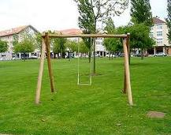

# Balanço de Novembro

Ufa, pensei que novembro não fosse passar ;) ! Este mês de novembro foi, sem dúvidas, bem movimentado em termos de trabalho. Na verdade, foi um mês de decisões e de encaminhamento. No trabalho muitas coisas começaram a mudar para melhor e, sinceramente, vejo que isto irá melhorar a qualidade do meu trabalho e a dos meu companheiros!

Por outro lado, este foi um mês em que escrevi bastante e publiquei pouco por aqui. Há algumas novas poesias que escrevi e estão na fila de espera. Com elas, novas melodias e alguns textos que estou prometendo publicar. Estes textos falam um pouco sobre as "Subclasses Tecnológicas", dentro de uma idéia do poder de consumo de tecnologia por todas as camadas da sociedade. Outro texto diz sobre a "minha relação com a Matemática" e como ela mudou a minha vida. E um outro sobre... hum... não me lembro bem, mas depois eu posto aqui.

Sobre o CraftMind, neste mês de novembro consegui atingir 1000 visitas em 5 meses!!! Não sei se está bom ou não, considerando que os leitores do blog são bastante escassos e que o que eu escrevo não é de interesse geral... ou é, sei lá! Mas estou contente com esta marca!

E para os meus leitores discretos, obrigado e até mais!
