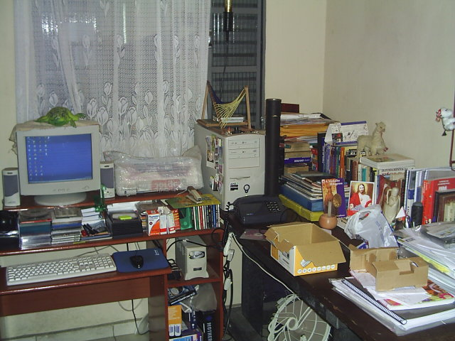
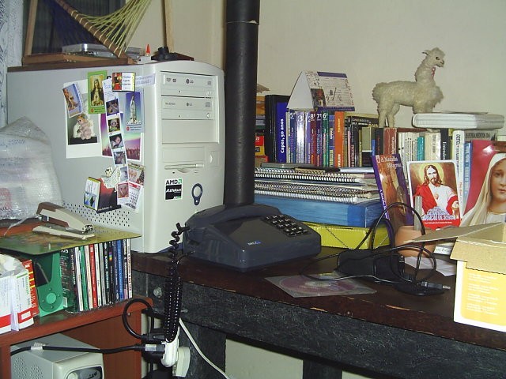
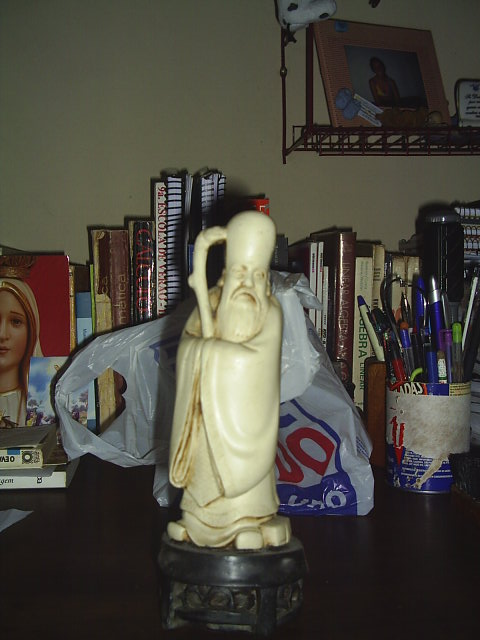

# Meu quarto, minha vida...

Nunca fui o cara mais organizado do mundo, mas eu tento me manter organizado. Isso para mim, é vital. Mesmo que minha organização seja um pouco caótica, eu sempre sei (na maioria das vezes) onde estão meus pertences.

Houve apenas uma época de minha vida em que tive um quarto só pra mim, e foi bem nessa época que as coisas eram realmente... caóticas:

*Meu quarto, minha vida...*

Bem, acho que algumas pessoas podem discordar dizendo serem capazes de entropias muitíssimos melhores do que a minha, mas podem acreditar: só eu saberia identificar um objeto específico entre os meus livros, cadernos, remédios (naquela época eu estava tomando remédios contra "Terror Noturno"), CDs, disquetes (nunca me livrei deles), caixas, badges, ímas, bonecos (da minha irmã, eles me faziam companhia) etc.

No meio disso tudo, havima coisas preciosíssimas para mim: meu computador (um Athlon XP 1800+, com 768 MB de RAM, 80 GB de HD, gravadores de CD e DVD - este durou apenas 6 meses, por módicos R$ 300,00 da época, placa de vídeo nVidia MX 400 de 64 MB, tudo isso montados numa placa discreta SOYO K7VTA PRO), meu parabolóide hiperbólico (não poderia deixar de ter um, dada a minha formação...), minha lama miniatura com pele de lama de verdade (um presente de uma amiga peruana, dos tempos de São Caetano) e minha estatueta do Confúcio (o melhor presente que minha prima me deu, e que infelizmente não sei mais do seu paradeiro - da estatueta, é claro). Cara, que falta sinto dessas coisas... principalmente desse meu computador (até hoje, nenhum outro que tive me fez tão feliz!).

*Itens básicos e essenciais de minha personalidade...*

O Confúcio não aparece aí na foto, mas ele é esse cara aqui:

*Confúcio, alguém viu ele por aí?*

Nessa época (2002~2005) eu estava cursando a faculdade em Guaratinguetá e eu sempre consegui viver muito xiquemente com a minha bagunça. Quando meus amigos vinham em casa, ficavam maravilhados com a quantidade de cacarecos e coisas para se olhar. Tudo tinha uma história, alguma coisa pra contar. Mas, como tudo que é bom acaba, mudei-me de cidade e toda a minha entropia se esvaneceu, como um balão estourando.

Atualmente estou morando em São José dos Campos, e estou me esforçando para não juntar muitos cacarecos e transformar meu quarto (o de visitas, pois agora sou um rapaz comprometido) novamente em bagunça, mas é difícil... Gerenciar o espaço para uma pessoa é complicado, sempre falta espaço para mais um ítem, mas para dois, tem-se que tomar muito cuidado!

Ontém foi domingo e perto da rodoviária tem uma feirinha da barganha. Nunca tinha ido lá e fui conferir as tranqueiras disponiveis. Achei de tudo. Em termos de videogames, achei desde Atari (funcionando!) até um nintendo Wii... Cameras de vídeo, fotográficas, relógios, toca-discos, ferramentas, tudo, tudo mesmo! Minha mão coçou para algumas coisas, mas só de pensar na bagunça que eu já estou começando a formar, pensei que fosse melhor começar a trocar meus cacarecos por outros, nessa talvez eu consiga reduzir ou manter a quantidade de bugigangas que fazem parte de mim! :P
