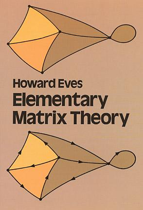

# Livro: Elementary Matrix Theory

Adoro pesquisar sebos. Em Taubaté tem uns dois sebos bem ensebados, com livros que vão - literalmente, desde o chão até o teto. Tudo pode ser encontrado por lá... Já em São José, embora more aqui há quase um ano, ainda não encontrei grandes sebos, mas tem um ([Sebo Eros](http://www.seboeros.com.br)) que também é muito bom. Umas semanas atrás, fui até lá pra tentar encontrar algum bom livro sobre estatística e sobre matrizes. Estes temas são muitíssimos importantes para mim, visto que em meu trabalho lido diretamente com eles. Fuçando aqui e lá, acabei encontrando o "**Elementary Matrix Theory**", de **Howard Eves**, em inglês. Dei uma folheada no pequeno livro e pude perceber que, além de não poder julgar um livro pela capa, não se pode julgá-lo pelo tamanho também. Pequeno, mas completo, este livro trata de aspectos bastante diversificados da teoria de Matrizes, indo desde a teoria mais elementar (como indica o título) até teorias mais avançadas sobre o tema. Indispensável para todos que trabalham ou precisam estudar matrizes. O preço, R$ 20,00 está bom? Para se ter uma idéia do valor desta aquisição, na Amazon, o mesmo livro (novo) sai por $ 11,00 (onze dólares), [aqui](http://www.amazon.com/Elementary-Matrix-Theory-Howard-Eves/dp/0486639460).

Agora, o de estatística, ainda não encontrei um que atenda as minhas expectativas... :/ Alguma sugestão aí?!
