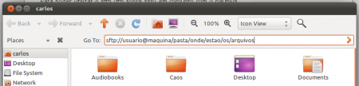
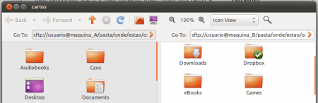

# Transferindo graficamente arquivos via ftp seguro

Esta dica é bastante rápida, mas muito útil. Quem trabalha com redes e com várias máquinas (considere máquinas bastante distintas em termos de configuração e software) sabe que nem sempre é tranquilo copiar ou mover arquivos pela rede. Na linha de comando, temos vários programas dedicados a esta tarefa, como o mais simples ftp, o mais aprimorado sftp e o mais completo ncftp. Todos eles fazem a mesma coisa, com a diferença nos recursos que oferecem. O que nem todo mundo sabe é podemos transferir arquivos entre máquinas diferentes utilizando uma ferramenta gráfica muito simples e conhecida: o gerenciador de arquivos. Ok, se isso for muito óbvio para você, me desculpe, mas estou falando de usar o sftp em conjunto com o nautilus do Gnome!

Para encurtar a história, considere que você precisa selecionar alguns arquivos dentre vários que estão na máquina A para a máquina B. Pelo terminal, isto pode ser uma tarefa bem simples também, mas a possibilidade de se utilizar o mouse neste tipo de operação, pode ser de grande valia.

Para poder utilizar o sftp (ftp sobre ssh) em conjunto com o nautilus, basta digitar o nome de usuário@maquina/pasta na barra de endereço, como na imagem a seguir:

[](http://craftmind.wordpress.com/2011/01/25/transferindo-graficamente-arquivos-via-ftp-seguro/sftp_nautilus2/)

Esta dica é bastante rápida, mas muito útil. Quem trabalha com redes e com várias máquinas (considere máquinas bastante distintas em termos de configuração e software) sabe que nem sempre é tranquilo copiar ou mover arquivos pela rede. Na linha de comando, temos vários programas dedicados a esta tarefa, como o mais simples ftp, o mais aprimorado sftp e o mais completo ncftp. Todos eles fazem a mesma coisa, com a diferença nos recursos que oferecem. O que nem todo mundo sabe é podemos transferir arquivos entre máquinas diferentes utilizando uma ferramenta gráfica muito simples e conhecida: o gerenciador de arquivos. Ok, se isso for muito óbvio para você, me desculpe, mas estou falando de usar o sftp em conjunto com o nautilus do Gnome!

Para encurtar a história, considere que você precisa selecionar alguns arquivos dentre vários que estão na máquina A para a máquina B. Pelo terminal, isto pode ser uma tarefa bem simples também, mas a possibilidade de se utilizar o mouse neste tipo de operação, pode ser de grande valia.

Para poder utilizar o sftp (ftp sobre ssh) em conjunto com o nautilus, basta digitar o nome de usuário@maquina/pasta na barra de endereço, como na imagem a seguir:

**No KDE:**


```
fish://usuario@maquina/pasta/onde/estao/os/arquivos
```


**No Gnome:**


```
sftp://usuario@maquina/pasta/onde/estao/os/arquivos
```


Outro recurso do nautilus que agragado ao uso do sftp ajuda bastante é o painel extra (basta pressionar F3 ou ir na barra de menus e apontar para View>Extra Pane). Assim fica bem fácil de selecionar e copiar/mover os arquivos desejados!

[](http://craftmind.wordpress.com/2011/01/25/transferindo-graficamente-arquivos-via-ftp-seguro/sftp_nautilus3/)
