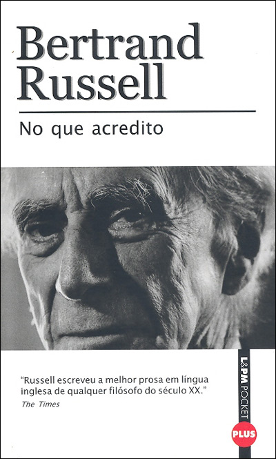

# Livro: No que acredito

Há algum tempo atrás, enquanto estava em uma livraria de rodoviária procurando alguma coisa para ler durante minha viagem, deparo-me com o livro "No que acredito" (What I believe, do original em inglês) de Bertran Russell, que foi um dos mais brilhantes filósofos (além de lógico e matemático) do século XX. Este livro, em particular, me chamou bastante a atenção por que é um livro pequeno (de bolso) e porque pensei que seria fácil de ler, além de ser mais um livro de Russell em minha biblioteca. Embora singelo, "No que acredito" traz consigo uma série de ensaios de Russell apresentando e discutindo idéias variadas sobre a vida, a moral, política e religião. Este livro foi originalmente publicado em 1925 e levou Russell a receber o prêmio Nobel de literatura em 1950, e é leitura obrigatória à todos que se interessam por filosofia e querem entender a obra de Russell.

O texto de Russell é bastante articulado e agradável de ler. As idéias expostas são bastante discutivas e embasadas em diversos ideais apoiados por Russell (como por exemplo o ativismo antinuclear). Achei bastante interessante as idéias apresentadas sobre vida virtuosa e ciência, sobre a morte, a felicidade e o amor. É um texto bastante sincero, quase uma conversa entre um dos mais brilhantes filósofos e o leitor na tentativa de se explorar questionamento existenciais (qual é o seu papel/lugar no universo?).
> A vida virtuosa é aquela inspirada pelo amor e guiada pelo conhecimento. (B. Russell)

Russell foi um destes filósofos que não acreditavam na adoração religiosa e acreditavam na essência do homem como sendo suficientemente bondosa para articular a própria prosperidade sem deixar o próximo. Acredito que esta tenha sido uma das idéias que levaram Russell a acreditar no homem, mesmo sendo ele passível de cometer os erros que comete. O teor ateísta de "No que acredito" nos faz pensar sobre as razões essenciais que fizeram Russell encarar assuntos como o sexo de forma bastante diferenciada dos demais pensadores de sua época. Além disso, Russell foi um ativista contra as asmas nucleares e foi bastante ferrenho em seus posicionamentos quanto aos rumos que a humanidade estava tomando em sua época.

Sempre me interessei pelas idéias de Russell desde que tomei conhecimento de suas idéias na faculdade. Fiquei fascinado por sua obra. Sua história com a Matemática e a Lógica ajudam a compor a história de nossa filosofia e da ciência.

Leitura mais do que recomendada, obrigatória.
