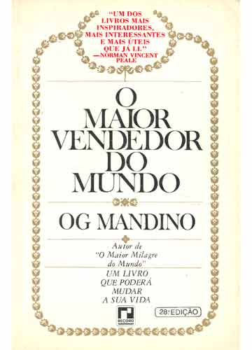

# O Maior Vendedor do Mundo

Quando eu tinha meus 16~18 anos, em uma das aulas de ensino religioso na escola, nos foi pedido a leitura de um livro para fazermos uma discussão sobre um tema que (provavelmente) ia desde humanismo até ética profissional. Uns assuntos vastos, polêmicos e interessantes também. Podíamos escolher o um livro que quissésemos desde que estivesse dentro da biblioteca da escola. Fuçando aqui e alí, acabei encontrando "O Maior Vendedor do Mundo", de Og Mandino.

Como isso já faz pelo menos 10 anos, ainda hoje consigo me lembrar desse livro. Na realidade, acho que este foi o primeiro livro que exerceu um impacto considerável sobre a minha pessoa. Primeiro porque eu não sabia exatamente o que esperar daquele pequeno livro de capa branca com adornos dourados. Segundo, porque eu realmente era preguiçoso para ler. Além disso, o autor era Og Mandino, alguém absolutamente desconhecido para mim. Naquele época, a internet não era como hoje e na escola, era "chato" de se usar. Os computadores eram lentos e as pessoas do laboratório de informática não entendiam bem como aquilo tudo deveria funcionar... Enfim, como eu não tinha muitas opções a não ser ler o livro, mergulhei de cabeça na tarefa, e como nunca antes na história de minha vida, me vi completamente envolvido com aquela leitura.

Basicamente, o livro falava sobre vendas e o próprio título do livro não me empolgou muito. Por que eu leria um livro sobre vendas em plena adolescência, época em que tudo o que eu queria que entrasse na minha cabeça era música? Certamente o assunto do livro, para mim, era bastante diferente de tudo o que eu já havia lido antes, mas lendo, começou a me parecer bastante interessante. Ele trazia algumas "lições" sobre o que significa ser um vendedor, o que siginifica valorizar o que você tem, o que significa ser e estar envolvido com os seus objetivos, sobre alcançar a felicidade. Bastante pertinente não? Com o tempo fui percebendo que o livro trazia muito mais do que lições. Havia um enredo bastante evidente, uma história que culminaria em exemplos fantásticos de vida. O fato é que rapidamente li aquele livro e acho que aprendi algumas coisas interessantes e bastante importantes com ele. Uma das coisas que mais me marcaram, entre outras, foi a idéia de tempo e de como você o emprega. No livro, havia algo como
> Você não pode ser o escravo do seu tempo, você deve ser o senhor do seu tempo.

Para um jovem adolescente ordinário (no sentido de ser comum) como eu, isso pode não ter tanta importância assim, pois é na vida adulta que o tempo começa a passar incrivelmente rápido enquanto nosso cérebro fica fisicamente babando na gravata... O tempo começa a ter uma importância realmente perigosa e torna-se uma necessidade começar a se preocupar com ele, com a forma com que o administramos. E isso realmente foi bastante crucial para mim. Acho que aprendi, de certa forma, a escolher o que posso fazer no tempo que tenho disponível e, frequentemente, sinto-me bastante livre para tomar minhas decisões e fazer minhas escolhas sem me atrapalhar muito.

Pois bem, certamente há várias coisas que influenciaram a minha postura depois que li e pensei sobre o conteúdo deste livro, e mesmo que eu não tenha percebido, eu sei que isto aconteceu. Não quero dizer que este livro mudou a minha vida, mas quero dizer que ele contribuiu um pouco com a minha forma de pensar, principalmente porque eu tive vontade de lê-lo em um período de amadurecimento em que as coisas mudam muito rápido na vida da gente.

Pra finalizar, eu realmente nunca soube quem foi Og Mandino e, como hoje em dia é trivial conhecer um pouco sobre alguém, fui na Wikipedia e lá estava ele, [Og Mandino](http://pt.wikipedia.org/wiki/Og_Mandino), um italiano radicado nos Estados Unidos (já falecido em 1996) e que entre tantas outras coisas coisas, teve muita coragem para largar uma vida de muitas obrigações com o trabalho para fazer o que gostava e o que tinha vontade de fazer e assim alcançar a plena felicidade. Muito provavelmente, este é um outro ensinamento que me fez enxergar a vida da forma como a enxergo hoje.

- Site oficial dedicado à obra de Og Mandino: <http://ogmandino.com>
- O Maior Vendedor do Mundo: tem no Google e provavelmente numa livraria perto de você.
