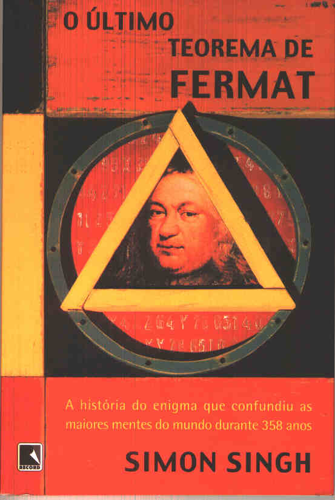
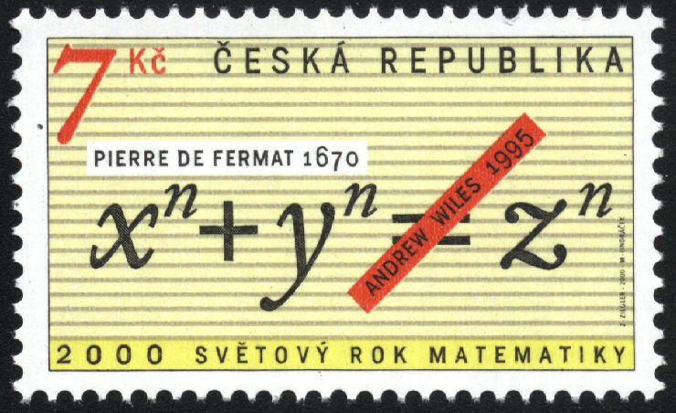
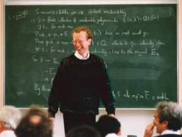

# O Último Teorema de Fermat

Sempre acho que o último livro que leio é o mais fantástico de todos. Mas acho que este é o mais fantástico livro sobre uma história da matemática que já li.

O Último Teorema de Fermat conta a saga "épica" de [Andrew Wiles](http://www.princeton.edu/admission/whatsdistinctive/facultyprofiles/wiles/) na busca pela prova da última conjectura deixada por [Pierre de Fermat](http://pt.wikipedia.org/wiki/Pierre_de_Fermat) em 1670. A conjectura, agora um teorema, estabelece que não existe soluções para a equação

$x^{n} + y^{n} = z^{n}$

 para 

$n > 2$

Este problema permaneceu sem um prova por mais de 300 anos quando em 1995 o matemático inglês (radicado nos EUA) Andrew Wiles consegue a façanha - épica, de prová-lo como sendo falso. A prova pesquisada por Wiles demandou, ao todo, sete longos anos de estudos contando com numerosas técnicas matemáticas, conectadas por um raciocício lógico extremamente intrincado imerso em diversos teoremas demasiadamente abstratos.

A prova estabelecida por Wiles pode ser alcançada por meio de uma outra conjectura, a de [Tanyiama-Shimura](http://mathworld.wolfram.com/Taniyama-ShimuraConjecture.html) (anos 1950), que propunha uma conexão entre a teoria das [curvas elípticas](http://mathworld.wolfram.com/EllipticCurve.html) e o campo da [formas modulares](http://mathworld.wolfram.com/ModularForm.html). Uma das consequências direta da prova desta conjectura seria a prova do [Último Teorema de Fermat](http://mathworld.wolfram.com/FermatsLastTheorem.html). Este insight foi levantado pelo matemático americano, [Ken Ribet](http://math.berkeley.edu/~ribet/), após ter estudado diversas outras tentativas de diversos outros matemáticos ao longo dos secúlos e ter conseguido finalmente mostrar haver uma relação entre a conjectura de Tanyiama-Shimura e o Último Teorema de Fermat. E foi pensando nessa conjectura que Wiles pôde atacar o problema.

O último teorema de Fermat permaneceu como um verdadeiro enigma para os matemáticos por séculos. Diversos grandes matemáticos tentaram atacar o problema com as técnicas disponíveis em suas épocas, mas sempre acabavam por esbarrar em alguma limitação lógica - sendo esta, frequentemente, consequência de algum erro de raciocício.

*Selo comemorativo à prova do Último Teorema de Fermat*

*Andrew Wiles logo após terminar sua primeira exposição sobre a prova do último teorema de Fermat, em Cambridge*

Finalmente, na primeira metade dos anos 1990, Andrew Wiles anuncia ter conseguido a prova à comunidade internacional matemática. A prova obtida por Wiles foi apresentada aos matemáticos em Cabridge (Inglaterra) e foi considerada uma verdadeira obra-prima pois em seu feito, Wiles conseguiu reuniur muitíssimas teorias elementares e avançadas além de inúmeras técnicas inovadoras desenvolvidas por ele mesmo. No entanto, o mais curioso é que mesmo tendo provado o último teorema de Fermat, ainda restava a dúvida de "como Fermat teria proposto uma prova à sua conjectura, uma vez que as técnicas disponíveis em sua época eram muito limitadas?". Certamente, Fermat não teria apresentado a mesma prova que Wiles pois a matemática da [Teoria dos Números](http://mathworld.wolfram.com/NumberTheory.html) de sua época estava longe de ser desenvolvida como é atualmente. Alguns matemáticos acreditam que, devido à grande genialidade de Fermat, seria realmente possível que ele tivesse uma prova para a sua conjectura. Outros, no entanto, acreditam que ele simplesmente estivesse blefando e que realmente não possuia uma prova, o que poderia ser explicado por sua vaidade pois Fermat vivia, não sendo um matemático profissional, vivia desafiando as grandes cabeças de sua época com enigmas e truques matemáticos. Vale lembrar que Fermat lançou o grande enígma para o mundo da matemática anotando na margem de uma cópia da *Arithmetica* de Diofante, a seguinte inscrição:

> Cuius rei demonstrationem mirabilem sane detexi. Hanc marginis exiguitas non caperet.

Em uma tradução para o português, teríamos algo como:
> Encontrei uma demonstração verdadeiramente maravilhosa disto, mas esta margem é estreita demais para contê-la.

O que é no mínimo curioso. Acho que este é tipo de história que mais me chama atenção no mundo da matemática. Não porque é uma história épica em um enigma, um problema que parecia ser inatingível e que é derrotado, mas porque ela mostra que os grandes matemáticos também foram frágeis, cometeram erros básicos e mesmo assim conseguiram dar suas contribuições à construção matemática e de suas teorias. Isso nos aproxima muito de um mundo que parece ser muito diferente de nossa realidade e que, muitas vezes, acompanhamos apenas de longe.

Ah, claro... Faltou comentar que o livro foi escrito pelo físico inglês [Simon Singh](http://www.simonsingh.net/) e virou um documentário da BBC. No documentário Andrew Wiles e todos os grandes matemáticos contemporâneos à nossa geração dão seus depoimentos sobre a época em que o mundo da Matemática foi revolucionado pelas descobertas impulsionadas pelo Último Teorema de Fermat.

<http://video.google.com/googleplayer.swf?docid=8269328330690408516>

Para saber mais (vale muito à pena, sempre!):

- Site de Simon Singh e o documentário feito para a BBC (<http://www.simonsingh.net/The_TV_Film.html>)
