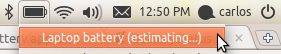
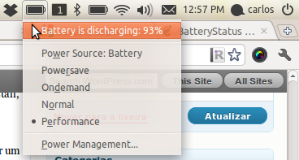
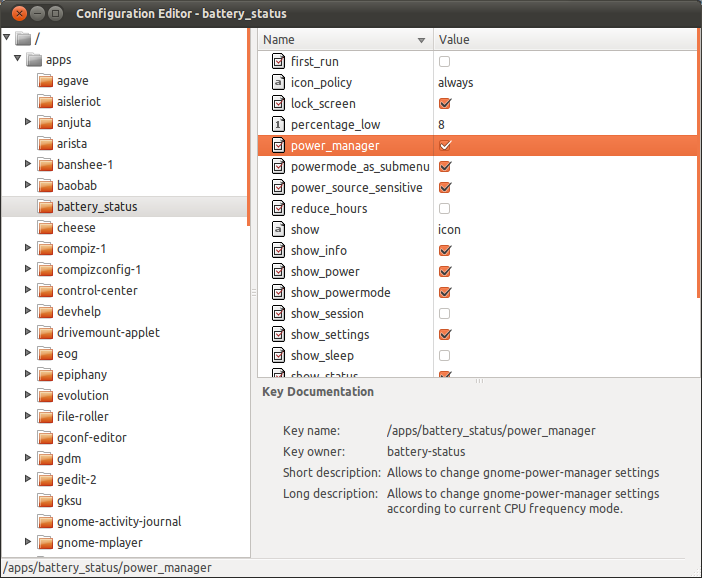

# BatteryStatus no Gnome

Quando comprei o meu HP G42, a primeira tarefa foi atualizar o sistema operacional. De cara, instalei o Ubuntu (na época 10.04). No post install, além de ter que instalar o driver da placa de som (que só saía pelo fone de ouvido :/) tive que resolver um problema relacionado à bateria: o marcador de estado da bateria, só mostrava “Laptop battery (estimating…)”, como na imagem abaixo:

[](http://craftmind.wordpress.com/2011/02/25/batterystatus-no-gnome/batterystatus_velho/)

Em um primeiro momento pensei que fosse necessaŕio fazer uma atualização e tudo estaria resolvido. Mas como tudo que tem graça, tem que ter um pouco de esforço. Para resolver o problema, instalei um medidor de bateria alternativo, que também é mantido pelo projeto Gnome: o BatteryStatus (<http://live.gnome.org/BatteryStatus>). Com ele é possível saber qual é o nível relativo da carga da bateria (eg, 90%, 50%, 12% etc). O problema é que ele não consegue calcular o tempo de descarga completa da bateria. Isso se deve ao fato de que alguns modelos de notebook da HP possuem modelos de bateria que simplesmente não informam qual é o tempo exato até a descarga. Então, o problema não é com o linux, mas com o hardware.

Para instalar (em qualquer versão do Ubuntu, a partir da 10.04 – nunca testei nas versões anteriores), basta adicionar o ppa, atualizar a lista de pacotes e instalar o programa:


```
$ sudo add-apt-repository ppa:iaz/battery-status
$ sudo apt-get update
$ sudo apt-get install battery-status
```


Feito isto, basta digitar Alt+F2 e digitar “/usr/lib/battery-status/battery-status –indicator”.

[](http://craftmind.wordpress.com/2011/02/25/batterystatus-no-gnome/batterystatus_novo/)

Para que o BatteryStatus do Gnome funcione corretamente, permitindo que a energia do notebook possa ser realmente gerenciada através dele, falta a pitada final: configurar o gerenciador de energia através do gconf-editor. Para isso, basta seguir os passos abaixo:

1. Abra o gconf-editor e vá para />apps>battery_status
2. Selecione a opção power_manager

[](http://craftmind.wordpress.com/2011/02/25/batterystatus-no-gnome/bsgnome/)

Pronto, agora o BatteryStatus do Gnome está corretamente funcionando e mostrando o tempo restante da bateria corretamente.
