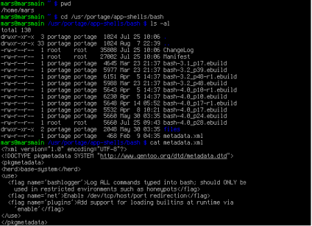
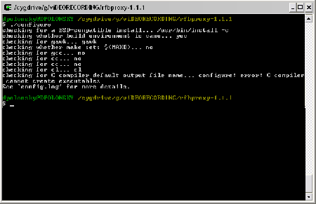

# Configurações básicas do Bash

Ter um interpretador de Shell devidamente configurado, além de ser importante para a organização do terminal, facilita a vida de muita gente que trabalha direto no terminal. Independente do gerenciador de janelas escolhidos, a maioria das distribuições atuais adota o Bash como o interpretador de Shell padrão do linux.

Dependendo o interpretador, o Shell pode ser configurado de muitas maneiras. Acho que a maneira mais adequada é aquela que permite sabermos em que pasta estamos e a partir disso digitarmos os comandos. O Shell mais estranho que utilizei é o do CYGWIN (o porte do “linux” para o Windows). Nessa configuração, o prompt fica na linha de baixo, logo depois da linha com as pastas onde se está. Esta configuração causa uma certa estranhesa no início, porque sempre se pensa que está pulando uma linha, mas também tem o lado prático por impedir que comandos muito longos tenham que ser completados na linha de baixo.

Para uma configuração básica e organizada do Bash, temos que levar em consideração três arquivos:

- .bashrc
- .bashr_aliases
- .bashr_profile

No primeiro, .bashr, estão as configurações da variável PATH, o formato do prompt e outras variáveis que podem ser acrescentadas quando programas são instalados a partir do código-fonte. No .bashr_aliases, são acrescentadas as aliases definidas pelo usuário e no .bashr_profile, estão as configurações que fazem parte tanto do sistema em si (linux) quanto do próprio Bash.
