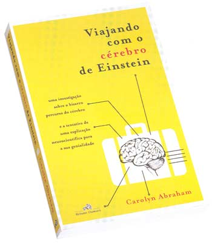

# Livro: Viajando com o cérebro de Einstein

De todos os livros que já li este é, de longe, o mais bizarro. Mas é bem escrito e por alguém bem informada e em sã consciência. "Viajando com o cérebro de Einstein" conta a infame história do cérebro morto de um dos maiores gênios de nossa história. O cérebro de Einstein fora retirado de sua caixa craniana pelo patologista americano Thomas Harvey, tendo sido fatiado e "distribuído" para diversos cientistas, espalhados pelos Estados Unidos.

Quando Einstein morreu em 1955, em seu testamento constava que seu corpo deveria ser cremado e que nenhuma parte de seu corpo deveria ser tomada como relíquia. Este posicionamento de Einstein, vinha da descrença na forma como as pessoas veneram outras pessoas famosas, sobre a forma como as pessoas conseguem idolatrar um ser comum. Todos sabemos que Einstein não foi uma pessoa ordinária, ele foi extraordinário, mas acima de tudo, uma pessoa comum com idéias suficientemente brilhantes para mudar os rumos da ciência.

Thomas Harvey, o médico escolhido por Otto Nathan (um dos executores do expólio de Einstein) permitiu que Harvey mantivesse conservado o cérebro de Einstein para estudo, sendo que qualquer resultado extraído destes estudos deveriam ser única e exclusivamente publicados revistas científicas, excetuando-se quaisquer possibilidades de exploração comercial ou meramente curiosa.

Nos cinco primeiros anos de pesquisa, o cérebro de Einstein foi examinado por diversos cientistas. Lâminas foram enviadas a cientistas espalhados por todo o país ao longo das décadas seguintes e assim iniciava-se a bizarra jornada itinerante do cérebro de Eisntein. Cada vez que Thomas Harvey se mudava (foram muitas vezes e para lugares distantes), o cérebro de Einstein conservado num pote de vidro ia junto. No fim das contas, p cérebro de Einstein acabou residindo em cima de uma geladeira, como um pinguim ornamental. Mas a história não acaba por aí...

Acho que a maior sacanagem dessa história toda, foi como "profanaram" o cérebro de uma pessoa, por acaso um dos maiores gênios da ciência, sem o qual certamente eu não estaria escrevendo este texto. Como pôde-se chegar a esta situação e expor os restos materiais de uma pessoa dessa forma, como se fosse um prêmio, ou um objeto de decoração. Sei o próprio avanço da medicina remete ao estudo de corpos de e órgãos de pessoas mortas, mas o cérebro... é bizarro.

Procurando um pouco na internet, encontrei um [site](http://www.ceticismoaberto.com/ciencia/2135/o-crebro-de-einstein) que mostra um documentário feito sobre a saga de um japonês em busca de uma relíquia, um naco do cérebro de Einstein. Esta história está reatratada no livro, mas fica bem clara no vídeo... assistam:

[Assistir ao vídeo no YouTube](http://www.youtube.com/watch?v=-XMKUEZn1Cs&w=480&h=390)

No mais, nos resta dizer,

RIP, Eisntein.
