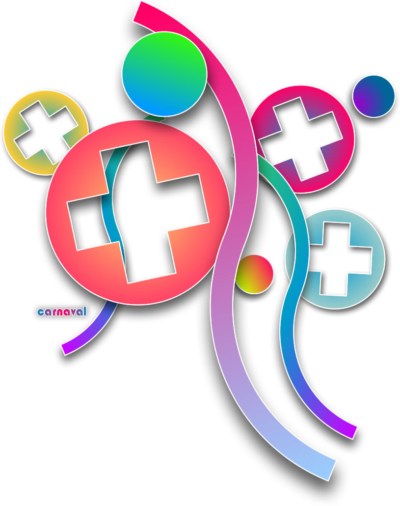

# Chega de Carnaval

Chega de Carnaval. Amanhã é quarta-feira de cinzas e, como em qualquer outro dia do carnaval, não quero me animar. Quero pular logo pra quinta-feira, pro dia de trabalho e voltar à minha vida normal. Nunca curti carnaval - exceto nas oportunidades em que eu tinha algo realmente interessante pra fazer, como música (mesmo que de mentirinha). Nos últimos vários anos de minha vida, carnaval significa cabo-de-guerra: de um lado uma vontade de fazer o que me der na telha e, no outro lado, a vontade de não pensar em trabalho. E nessa de não pensar em trabalho, eu penso em trabalho. Que loucura. Acho tão mais legal quando eu posso pensar em trabalho e trabalhar normalmente, no meu local de trabalho, com as pessoas com quem trabalho... aí sim pra mim é um carnaval :)
PS.: Tirando a parte anormal deste post (não gostar de carnaval e achar que o resto do ano é um carnaval, eu acho que um feriado desses sozinho em casa não é pra gente normal, certo?!)
