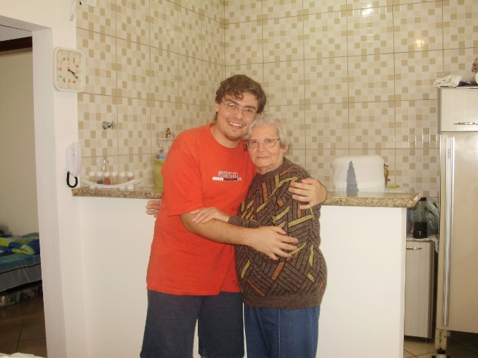

# Distante

Essa poesia é para minha vó, minha querida vó. Esteja onde estiver, a distância será sempre pequena, porque nunca deixei de dizer que a amei e nunca deixarei de escutá-la em meu sonhos!

**Distante**

E o tempo fica cada vez mais distante,
cada vez mais ofegante,
cada vez mais minguante.

Sua passagem é plena e confunde a cabeça do viajante,
que deixa tudo para trás, para viver outras memórias, novos instantes.
E sua soberba ironia nos ensina cada vez mais sobre sua vitória fatigante.

O que podemos contra o tempo
sem dizer que estamos distantes,
pois de repente tudo fica cinza e as aparências marcantes...

Só queria dizer mais uma vez
o que nunca deixei de dizer,
e ouvir mais uma vez o nunca deixarei esquecer.

O que passou marcou como ferro ao fogo
e deixou suas marcas nos ensinamentos com a alma e o espírito em repouso.
Nunca me esquecerei, apesar desta distância, daquilo que pode animar:

Porque jamais será realmente distante, a certeza de que tudo se faz sonhar.

