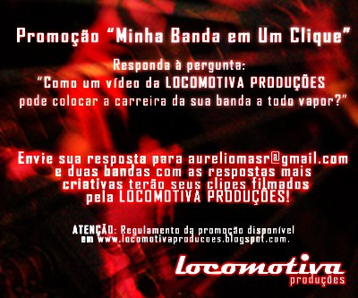

# Concurso Cultural! (Encerrado)

Você tem uma banda? Você gostaria de gravar um videoclipe com qualidade profissional para ajudar a impulsionar a carreira da sua banda? Claro que sim!!! Essa é a sua oportunidade de gravar o seu videoclipe de graça! Basta participar do concurso cultura da [Locomotiva Produções "Minha Banda em um Clique"](http://locomotivaproducoes.blogspot.com/p/minha-banda.html). Basta escrever um frase respondendo à pergunta **"Como um vídeo da LOCOMOTIVA PRODUÇÕES pode colocar a carreira da sua banda a todo vapor?"** Envie sua resposta para <aureliomasr@gmail.com> e duas bandas com as repostas mais criativas terão seus clipes filmados pela [Locomotiva Produções](http://locomotivaproducoes.blogspot.com/)!

**ATENÇÃO:** Instruções, regulamento e condições, vide abaixo.

[Assistir ao vídeo no YouTube](http://www.youtube.com/watch?v=w5AJmPsuvl4)

**Regulamento da Promoção "Minha Banda em Um Click"**
**Prêmios:**
1. Produção de um vídeo-clipe musical inteiramente grátis para a primeira colocada.
2. Produção de um vídeo-clipe musical com um desconto de 50% para a segunda colocada.

O clipe será divulgado pela Locomotiva em todas as redes sociais onde ela está presente: Orkut, Facebook, Twitter e Blogger. Será entregue à banda um DVD com o clipe e Making Of de até 15 minutos.

**Divulgação do Resultado:**
1. A promoção tem início à 00:00 do dia 23/05/2011 e termina às 23:59 do dia 03/06/2011.
2. A divulgação do resultado ocorrerá em até 07 (sete) dias úteis após o término da promoção.
3. O resultado será divulgado nos perfis das redes sociais onde a Locomotiva Produções e seu responsável - Marco Aurélio Silva Resende - estão presentes, nos seguintes endereços:

**Facebook:**
<http://www.facebook.com/locomotiva.producoes>
<http://www.facebook.com/curelio>
**Twitter:**
Seguindo o perfil [@aureliomasr](http://twitter.com/aureliomasr)
**Orkut:**
<http://www.orkut.com.br/Main#Profile?uid=1109883404971916912>
<http://www.orkut.com.br/Main#Profile?uid=10853890958310587862>
**Blogger:**
<http://www.locomotivaproducoes.blogspot.com>

3.1. O resultado também será divulgado nos sites dos parceiros da Locomotiva Produções:

 **Porão do Rock Prados:** [www.poraodorockprados.com](http://www.poraodorockprados.com/)

4. Caso a banda premiada com o primeiro lugar não manifeste interesse, seu prêmio passará automaticamente para a segunda colocada. Será feito novo sorteio para determinação da nova banda que ficará em segundo lugar.
5. Caso a banda que foi sorteada em segundo lugar não manifeste interesse, será feito novo sorteio.
6. O prazo para manifestação de interesse é de 5 (cinco) dias após a divulgação do resultado.

**Da Produção dos Clipes:**
1. As bandas sorteadas deverão escolher qual será a música que terá seu vídeo-clipe produzido e enviar o arquivo com a música e a letra da mesma em até 07 (sete) dias após a divulgação do resultado para o email aureliomasr@gmail.com.
2. As bandas terão direito a duas reuniões (individuais) com a Locomotiva Produções para desenvolver as ideias, o roteiro do clipe, definir locações e datas de filmagens, além de suporte on line via e-mail e MSN.
3. As filmagens deverão ser realizadas em duas sessões agendadas previamente.
3.1. Havendo a necessidade de reagendamento, o mesmo deverá ser feito com até 48 horas de antecedência, conforme disponibilidade da Locomotiva Produções e da banda.
4. Os clipes serão entregues em até 60 (sessenta) dias após a data de término das filmagens.
5. O primeiro clipe a ser produzido será da segunda banda sorteada.

**Responsabilidades:**
1. A Locomotiva Produções irá se responsabilizar pelo próprio deslocamento, equipe e o que mais for necessário para que as filmagens possam acontecer da melhor forma possível.
2. A banda deverá se responsabilizar pelo próprio deslocamento, transporte e montagem de equipamento, sonorização ambiente para reprodução do playback da música, bem como providenciar as autorizações para uso de espaço de terceiros.
**Requisitos para participação:**
1. Ter uma música gravada em estúdio ou com qualidade profissional.
2. Preferencialmente, a música deverá ser composição da banda.
3. A música deverá ser entregue para a Locomotiva Produções em formato WAV ou MP3, com taxa de 192 Hz e 320 kbps ou superior.
4. As locações para as filmagens não poderão exceder a distância de 200 Km da cidade de Dores de Campos, Minas Gerais.
5. Cada banda deverá responder à pergunta: ""Como um vídeo da Locomotiva pode colocar a carreira da sua banda a todo vapor?". Só é válido uma resposta por banda e as respostas serão avaliadas por parceiros da Locomotiva para seleção da mais criativa.
5.1. As frases deverão ser enviadas para o e-mail aureliomasr@gmail.com, o qual será respondido com uma confirmação. Caso não receba a confirmação em até dois dias, favor entrar em contato através do MSN aureliomasr@hotmail.com.
5.2. A banca examinadora terá acesso somente às frases, não sendo relacionadas as bandas e respectivas frases.
5.3. A banca examinadora principal será composta pelas seguintes pessoas, as quais não têm ligação direta com as bandas ou não são moradoras do Estado de Minas Gerais, desconhecendo assim os membros das bandas. Haverá uma banca examinadora secundária, composta por pessoas que foram selecionadas por serem parceiros ou estarem diretamente ligados às atividades da Locomotiva Produções.

**Banca Examinadora I (Voto com Peso 5):**
(Sobrenomes omitidos para preservar a identidade dos jurados.)

- Rodrigo (Programador, Músico. São Paulo/SP)
- Carlos (Matemático, Músico. São José dos Campos/SP)
- Bruno (Gerente de Comércio Exterior, Produtor de Vídeo. Itajaí/SC)

**Banca Examinadora II (Voto com Peso 2):**

- Eliane Aparecida Morais (Namorada Marco Aurélio/Locomotiva Produções)
- Philippe Belchior Resende (Amigo e fotógrafo responsável pela Alpha 7 Photo Design)
- Ubiratan Belchior Junior (Amigo e ex vocalista da banda Desplacados, junto com Marco Aurélio)
- Saulo Elias da Silva (Amigo e ex-baterista da banda Icarus, junto com Marco Aurelio)

**Voto de Desempate:**

- Marco Aurélio Silva Resende (Responsável pela Locomotiva Produções)

**Da Seleção das Frases:**
1. Cada um dos membros irá escolher três frases, ordenando-as em primeiro, segundo e terceiro lugar. Serão somadas as pontuações dadas por cada um dos membros, decidindo-se assim as três melhores frases, sendo que a terceira colocada somente será divulgada em caso de desistência de algum dos dois primeiros colocados.
2. O Concurso somente irá acontecer com no mínimo 05 (cinco) participantes.
