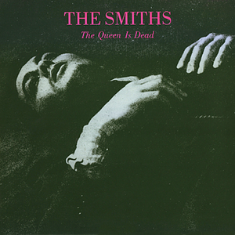

# The Queen is Dead

The Queen is Dead é um dos melhores discos dos "The Smiths". Tenho escutado direto esse disco e ainda não consigo entender como pude ignorar essa banda por tanto tempo. A banda é excelente e as músicas são incríveis!! Mais uma banda para a minha coleção ;)

Um pouco sobre este disco incrível (texto retirado de [LastFM](http://www.last.fm/music/The%20Smiths/The%20Queen%20Is%20Dead/+wiki)):
> The Queen Is Dead is the third studio album by the English rock band The Smiths. It was released on 16 June 1986 in the United Kingdom by Rough Trade Records and released in the United States on 23 June 1986 through Sire Records. The album reached number two on the UK album chart, maintaining a chart residency for 22 weeks, number 70 on the Billboard 200, and was certified Gold by the RIAA in late 1990. It has sold consistently well ever since.

O mais engraçado é que eu sempre me encontrei com pessoas que gostavam dos "The Smiths", mas nunca dava bola nem nada. Pra mim, "The Smiths" e "U2" eram a mesma coisa... ainda mais depois que descobri que meu cunhado gosta dos Smiths, aí foi o fim mesmo :P Mas com o tempo vem a rendição, você escuta uma música aqui, outra alí e vai achando legal. Mas quanto ao U2, ainda não tenho muitas esperanças.
