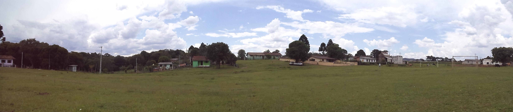
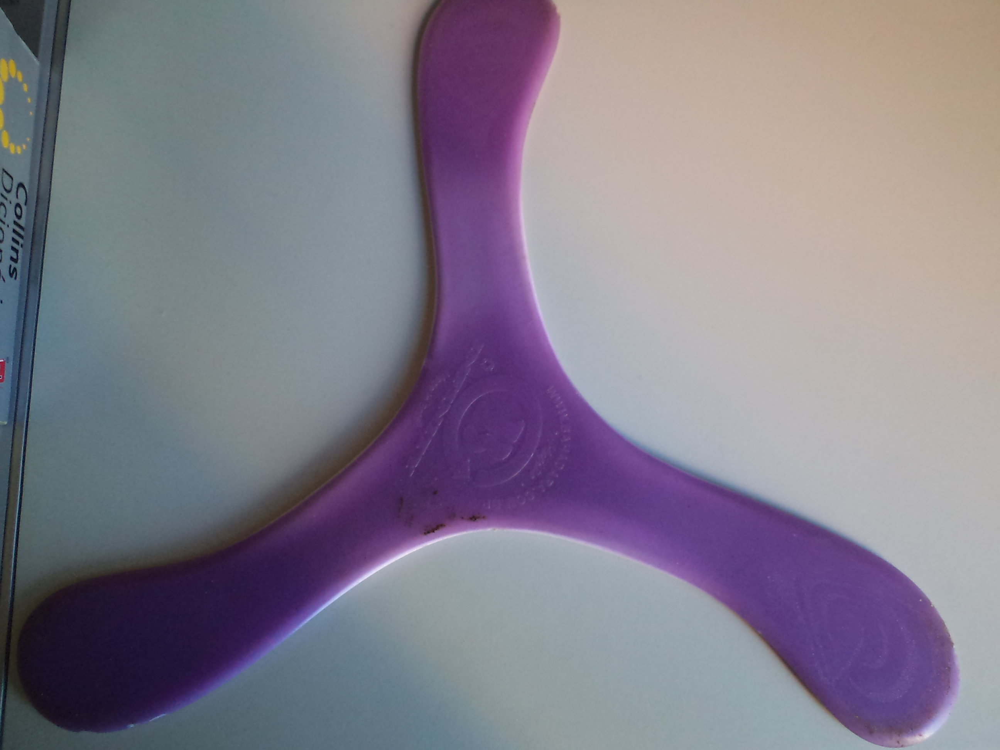
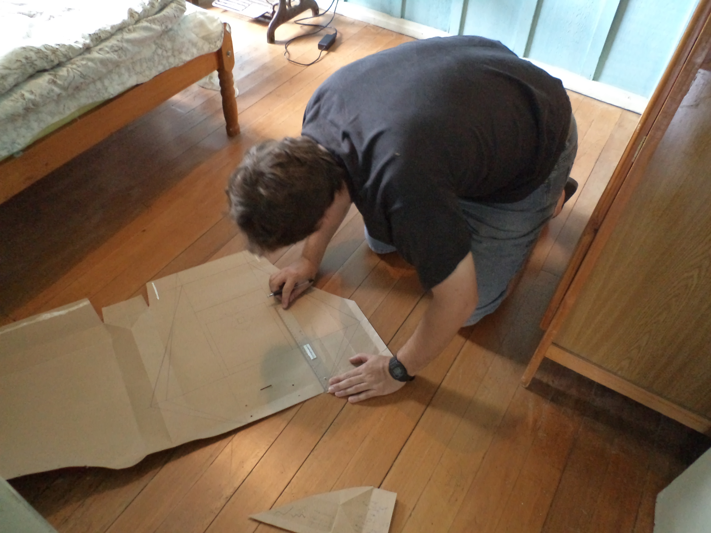
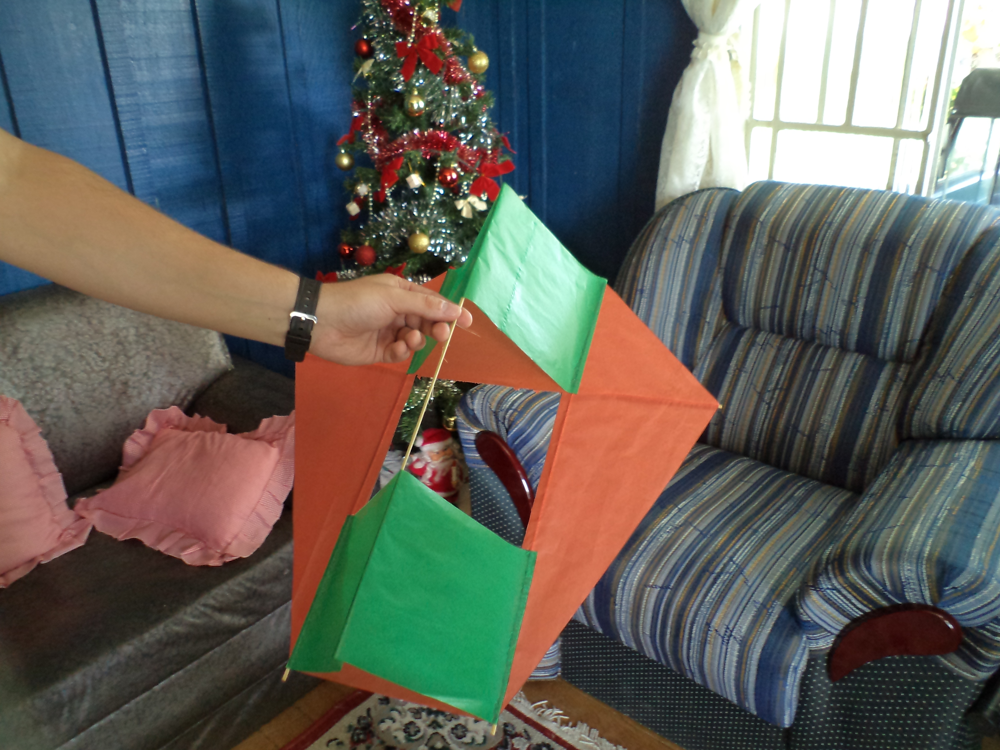

# Bumerangues, pipas e as dores remanescentes de 2011

Ano novo, vida nova. Um clichê é ótimo para começar o ano e fingir que tudo foi resetado, que os problemas acabaram e que as dívidas foram perdoadas. Embora isso seja possível com uma boa dose de coragem, é um tanto quanto difícil enganar o corpo e ignorar a dor. No fim de 2011, como sempre, fui para a casa da sogrinha no pacato distrito de Patos Velhos, na cidade de Prudentópolis, no interior do Paraná. Eita nóis, como esse lugar é bom e tranquilo. Comida boa não falta e o relógio se atrasa como nunca. Claro que isso só se aplica para recém-nascidos e aposentados inativos. Para o resto dos mortais, é a mesma correria de sempre. Pensando em diversificar minhas atividades no final desse ano, resolvi fazer duas molecagens: lançar bumerangue e empinar pipa. Na primeira, quase quebrei um dedo, na segunda quase me desfaço de uma costelinha.

O local:

Lançar bumerangues é uma atividade, ou melhor - esporte, bastante interessante, desde que se econtre o lugar perfeito para isso: um local aberto e longe de fios de alta tensão (perfeito também para empinar pipas). Como todo bom principiante no esporte, resolvi comprar um bumerangue simples de três pontas (esse [aqui](http://www.bahadara.com.br/produto.aspx?ProCodigo=12)), mas com alcance de uns 25 metros. Depois de umas boas tentativas, posso dizer que lançar bumerangues é um ótimo exercício físico. Como sou sedentário (não me orgulho nem um pouco disso), qualquer atividade que mova a minha carcaça é ganho. O problema são as dores que você ganha se não faz um alongamentosinho básico antes de iniciar os lançamentos. Lançar um bumerangue significa fazer com que ele volte para você se ele não atingir um alvo específico. No meu caso, eu era o alvo. Na primeira vez que ele voltou para mim, acertou a minha perna. Na segunda, fui pegar e quase quebro meu polegar. Há toda uma técnica de se lançar e apanhar o artefato, portanto, muito cuidado! No mais, é uma excelente atividade e com treino, pode-se atingir a perfeição. Como dica para a preservação do seu bumerangue, prefira lançá-lo em um local onde o pouso dele seja amortecido. Se você deixar ele cair no asfalto, ele não vai durar muito tempo. O meu, de plástico (ABS), ficou assim depois de vários lançamentos sem sucesso, com frequência ele caía de ponta no chão.  Note como as hastes dele vão ficando esbranquiçadas. Elas ficam assim porque se torcem quando atinge o chão com velocidade:

A seguir, alguns dos meus lançamentos:

[Assistir ao vídeo no YouTube](http://youtu.be/PdJEpStmEOY)

E como deve ser feito (só achei esse vídeo depois das minhas tentativas, erradas!):

[Assistir ao vídeo no YouTube](http://youtu.be/zuEBNuGHpaw)

Como dica, comece com bumerangues pequenos. Talvez seja uma boa idéia, pois eles voam baixo e são mais leves. Assim é mais difícil você se machucar na pegada e pode aprender mais rápido a dominar o lançamento do bumerangue.

Empinar pipas, por outro lado, não foi a melhor idéia que tive. Nessa, por incrível que parece, quase quebrei uma costela. Como? Cai em cima de mim mesmo, não me pergunte como. Inventei de fazer uma pipa "carambola", toda legal, tridimensional e tals. No dia em que fui soltar, não tinha muito vento, então sai correndo dando linha pra ver se a danada subia e... poft, me atropelei. Fiquei olhando pra pipa e esqueci do terreno acidentado. Ai ai ai, acabou a brincadeira. Portanto, se você estiver em um local seguro para empirar pipas, ou que permita qualquer outra atividade ao ar livre, tome cuidado com você mesmo. Todo cuidado é pouco!!

Fazendo o molde da pipa carambola:

Ela pronta:

A receita toda está [aqui](http://www.coatscrafts.com.br/NR/rdonlyres/0CE7F046-D5E4-48E6-A032-5756743696AE/109468/carambola1.pdf).

A seguir, o teste drive da pipa:

[Assistir ao vídeo no YouTube](http://www.youtube.com/watch?v=LYwgqjp-6zc)

E sobre 2012, que seja de mais desafios e menos dores.
