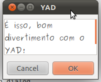

# Instalando o YAD no Ubuntu

Esta dica é simples, e deve servir também para as versões mais recentes e não muito distantes da versão 11.04 do Ubuntu. O [YAD - Yet Another Dialog](http://code.google.com/p/yad/), um fork do projeto [Zenity](http://library.gnome.org/users/zenity/stable/), fornece uma forma simples e fácil de criar interfaces gráficas para os seus scripts em Shell, aproveitando a biblioteca GTK do projeto Gnome.

Para instalar o YAD, você vai precisar do pacote de desenvolvimento da biblioteca GTK, o libgtk2.0-dev. Para instalar:


```
$ sudo apt-get install libgtk2.0-dev
```


Depois disso, basta baixar o [pacote de instalação do YAD](http://code.google.com/p/yad/downloads/detail?name=yad-0.16.3.tar.xz) e seguir a instalação com os tradicionais "configure, make e make install":


```
$ tar Jxvf yad-0.16.3.tar.xz
$ cd yad-0.16.3
$ ./configure --prefix=/opt/yad-0.16.3
$ make
$ sudo make install
```


No comando "configure" eu especifiquei uma pasta de instalação "/opt/yad-0.16.3", porque prefiro instalar todos os meu programas-fonte no /opt, mas se vocẽ preferir, pode escolher qualquer outro local, desde que configure o PATH para enxergar o local da instalação. Para isso, basta editar o arquivo "/etc/bash.bashrc" e acrescentar as seguintes linhas no final:


```
$ sudo vim /etc/bash.bashrc
###
# YAD
export PATH="/opt/yad-0.16.3/bin":${PATH}
export MANPATH="/opt/yad-0.16.3/share/man":${MANPATH}
```


Feito isso, basta fazer um teste:


```
$ yad --text-info --fontname="Purisa" --wrap --filename=/home/carlos/texto
```


E o resultado é:

[](http://craftmind.wordpress.com/2012/02/09/instalando-o-yad-no-ubuntu/screenshot-yad/)
