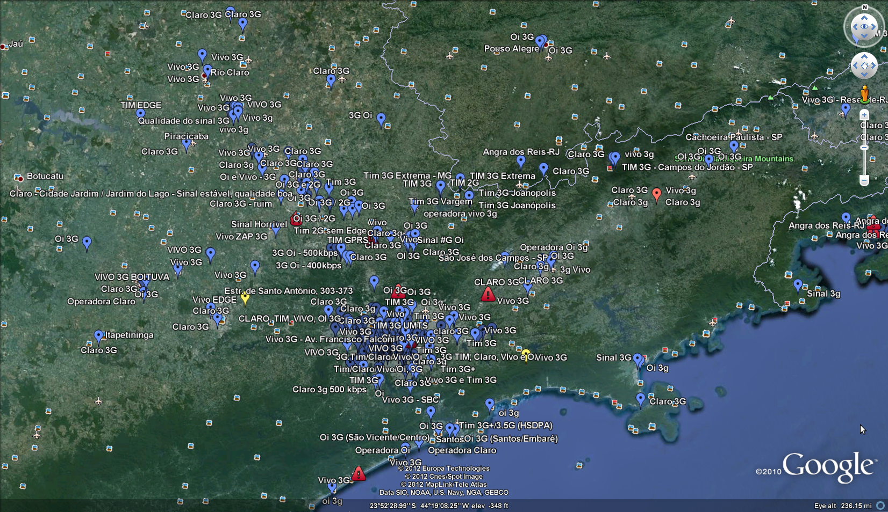
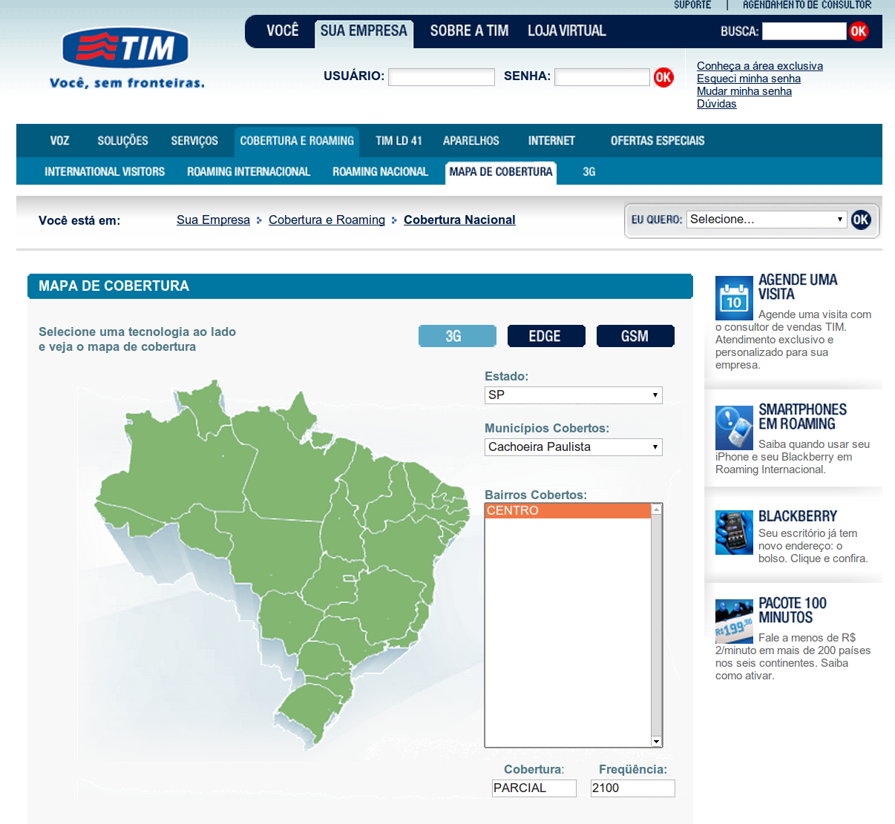

# Sinal 3G no Brasil

Uma dica:

Procurando informações sobre a cobertura de sinal 3G das operadoras TIM, VIVO e CLARO, acabei tropeçando em um arquivo kml do Google Earth com as áreas de cobertura no Brasil. Não sei até que ponto as informações estão corretas e atualizadas, mas dá para ter uma idéia de como é e quais são as regiões mais densas:

Para baixar o arquivo kml, basta clicar [aqui](http://www.google.com/maps/ms?ie=UTF8&hl=en&oe=UTF8&msa=0&msid=113976276902643639906.00046b32d8f3dec0276ba&output=kml). Se você quiser saber se há sinal 3G na sua cidade, sugiro que entre no site da sua operadora e procure pelo termo "cobertura 3G". No caso da TIM, tem um serviço bem prático neste [site](http://www.tim.com.br/portal/site/PortalWeb/menuitem.49fdc366f3ae6d3ca2fdb810703016a0/?vgnextoid=a541dcc39eb72110VgnVCM100000a22e700aRCRD&wfe_pweb_area=59&wfe_pweb_estado=26&). Fiz uma busca pela minha cidade (Cachoeira Paulista) e descobri porque o sinal é instável (cobertura parcial, só no centro da cidade!):

 

Para saber mais sobre os diferentes tipos de sinais existentes, sugiro a leitura deste artigo no GuiaDoHardware.net:

<http://www.hardware.com.br/dicas/gprs-edge.html>

Este artigo é interessante porque explica a diferença entre os diferentes tipos de sinais e lhe ajuda a entender melhor porque a velocidade da sua internet móvel é lenta ou rápida.
