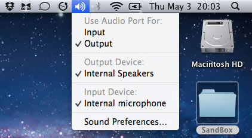
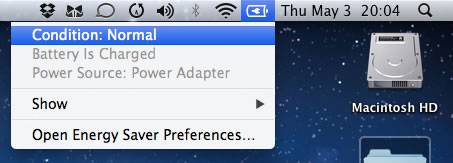
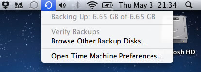

# Opções avançadas na barra de menus do Mac OS X Lion

Recentemente migrei para o Mac OS X Lion e tenho aprendido muitas coisas novas, principalmente sobre o Mac OS X. No Lion, há algumas coisas interessantes e que são bastante úteis (e lógicas também) para a configuração do desktop em si.

No teclado do MacBook Pro, há uma tecla chamada "Option" e que serve como uma tecla de submenu em geral ou uma tecla de... opções!

Se você segurar a tecla Option enquanto clica nos ícones da barra de menus, vai perceber que outras opções surgem, dependendo do ícone:

 Com a tecla Option pressionada, pode-se acessar outras opções para cada item. Neste caso, informações avançadas sobre o dispositivo de som podem ser acessadas.

 Neste caso, informações avançadas sobre o estado da bateria podem ser acessadas.

 E neste caso, temos opções diferentes para o Time Machine, quando pressionamos a tecla Option durante o clique.

Nestes exemplos, é interessante notar que as opções que podem ser ajustadas acessando-se o painel de Preferências do Sistema do Mac OS X, podem ser rapidamente acessadas com o auxílio da tecla Options. Ah, e se você gosta de "andar entre as palavras", seja no terminal ou em qualquer editor de texto, basta segurar a tecla Control e usar as setas para direita/esquerda para avançar ou retroceder ou as teclas para cima/baixo para avançar entre os parágrafos.

Como um bônus, vai a dica de uso da tecla "Command", que tambem tem suas utilidades: se você realizar os mesmos procedimentos, mas desta vez segurando a tecla Command e tentar arrastar os ítens para direita ou esquerda, vai perceber que poderá reorganizá-los na barra de menus!

 Com a tecla Command pressionada, pode-se reorganizar os itens do menu.

É isso!
