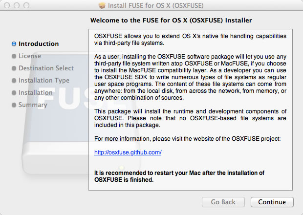
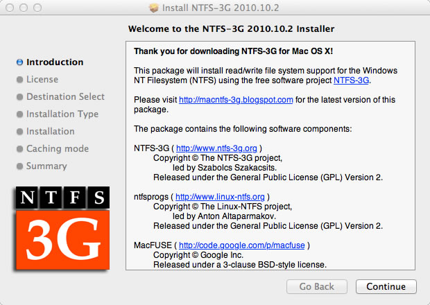
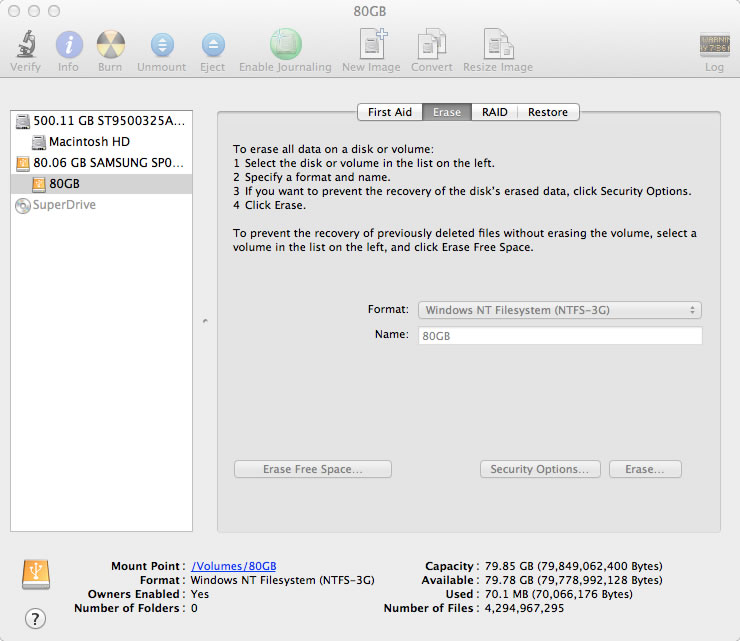
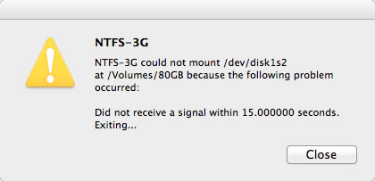

# NTFS no Mac OS X Lion

Nativamente, o Mac OS X não oferece suporte ao sistema de arquivos NTFS que é o padrão no Windows. Se você usa computadores com sistemas diferentes, principalmente Windows, pode querer manter um HD externo em NTFS para que possa utilizar no Mac OS X, no Linux e no Windows. No Linux, o suporte à leitura e escrita já é bem suportado e conhecido; no Mac OS X - pelo menos até a versão Snow Leopard, também. O problema começa a surgir no Mac OS X Lion devido à falta de atualização do programa MacFuse que provia o suporte de leitura e escrita em partições NTFS. Por isso, projetos em paralelo surgiram e hoje temos disponível o OSXFuse, que faz o papel do MacFuse nas versões mais recentes do Mac OS X, tal como o Lion. Vale lembrar que o OSXFuse mantém retrocompatibilidade com as outras versões do Mac OS X.

**Instalação**

Para habilitar o suporte à leitura e escrita em partições NTFS no Mac OS X Lion, você vai precisar instalar primeiro o [OSXFuse](https://github.com/osxfuse/osxfuse/downloads) - que na verdade funciona como uma espécie de gerenciador de plugins onde os plugins são os diferentes sistemas de arquivamento que se deseja habilitar no Mac OS X.

 Instalação do OSXFuse

Em seguida, basta instalar o [NTFS-3G](http://sourceforge.net/projects/catacombae/files/NTFS-3G%20for%20Mac%20OS%20X/2010.10.2/ntfs-3g-2010.10.2-macosx.dmg/download) que realmente traz a biblioteca do NTFS para o Mac OS X.

 Instalação do NTFS-3G

Depois de instalado o NTFS-3G, é recomendada a reinicialização do Mac.

**Uso**

Para começar a formatar seus discos em NTFS, basta utilizar o próprio Disk Utility ou qualquer programa de sua preferência:

 Formatando em NTFS com o Disk Utility do Mac OS X Lion

**Sobre o suporte**

Nos meus testes, consegui formatar um disco externo IDE de 80GB em NTFS utilizando o Disk Utility do Mac OS X Lion, tal como esperado. Mas logo depois da formatação, surgiu a seguinte mensagem:

 Mensagem de aviso do Disk Utility do Mac OS X

**EDIT (21/05/2015):** Para evitar esta mensagem, instale também o pacote "[Fuse Wait](https://github.com/bfleischer/fuse_wait/downloads)".

Tirando isso, não tive outros problemas. Parece que este solução "gratuíta" do NTFS-3G não é tão bem polida quando a [versão paga do Tuxera](https://secure.avangate.com/order/checkout.php?CART_ID=5548ef88feeaf7c86eb56060832c879b).

É isso!
