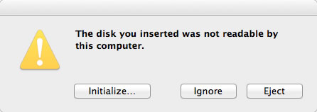

# Gravando uma imagem iso em um pendrive pela linha de comando no Mac OS X

Para gravar uma imagem iso em um pendrive pela linha de comando no Mac OS X, siga os seguintes passos:

1) Insira o pendrive e no terminal, digite:


```
$ diskutil list
```


Este comando irá listar todos os discos e partições do seu computador.

2) Verifique o nome do disco alvo (exemplo: /dev/disk1):


```
/dev/disk0
 #: TYPE NAME SIZE IDENTIFIER
 0: GUID_partition_scheme *500.1 GB disk0
 1: EFI 209.7 MB disk0s1
 2: Apple_HFS Macintosh HD 499.2 GB disk0s2
 3: Apple_Boot Recovery HD 650.0 MB disk0s3
/dev/disk1
 #: TYPE NAME SIZE IDENTIFIER
 0: FDisk_partition_scheme *1.0 GB disk1
 1: DOS_FAT_32 UBUNTU 1.0 GB disk1s1
```


3) A seguir, desmonte o disco com o comando:


```
$ sudo diskutil unmountDisk /dev/disk1
```


4) Para gravar a imagem, utilize o comando dd:


```
$ sudo dd if=/path/para/o/arquivo.iso of=/dev/disk1 bs=1M
1 bs=1m
701+1 records in
701+1 records out
735358976 bytes transferred in 606.272778 secs (1212918 bytes/sec)
```


Aguarde alguns minutos e pronto!

Se a mensagem abaixo aparecer, não se preocupe, porque provavelmente o sistema de arquivos que foi descompactado no pendrive (no caso o ext4 do ubuntu) não pode ser lido nativamente pelo Mac OS X:

[](http://craftmind.wordpress.com/2012/05/13/gravando-uma-imagem-iso-em-um-pendrive-pela-linha-de-comando-no-mac-os-x/mensagem/) Se você não quiser montar o pendrive, basta clicar em "Ignore" ou em "Eject"
