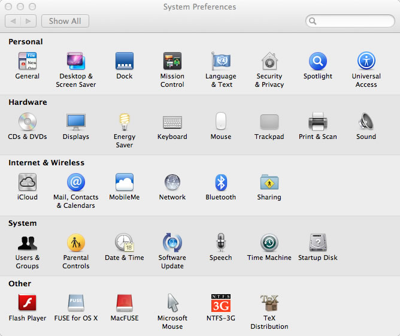
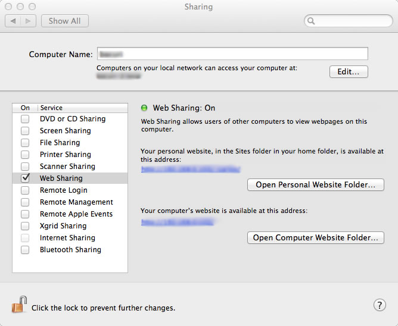

# Habilitando o servidor Apache com PHP no Mac OS X Lion

O Mac OS X Lion já vem com o servidor web Apache e o PHP instalados por padrão. Para habilitá-los, primeiro edite o arquivo **httpd.conf** em **/etc/apache2**e decomente a linha "LoadModule php5_module libexec/apache2/libphp5.so". Para isto, basta remover o "#" do começo da linha:


```
$ cd /etc/apache2
$ sudo vim httpd.conf
LoadModule php5_module libexec/apache2/libphp5.so
```


Isso irá garantir que ao iniciarmos o Apache, ele carregará os módulos do PHP.

Para habilitar o servidor Apache, abra o Painel de Controle do Mac OS X e clique em Compartilhamento (Sharing):

[](http://craftmind.wordpress.com/2012/05/17/habilitando-o-servidor-apache-com-php-no-mac-os-x-lion/painel_controle/) Painel de Controle do Mac OS X Lion: clique em Sharing (Compartilhamento) para habilitar o servidor web Apache

[](http://craftmind.wordpress.com/2012/05/17/habilitando-o-servidor-apache-com-php-no-mac-os-x-lion/compartilhamento/) Opções de compartilhamento do Mac OS X Lion: clique em "Web Sharing" para ativar o Apache

Com isso, você será capaz de utilizar o seu Mac OS X Lion como servidor, podendo inclusive fornecer o endereço indicado (em azul) para qualquer computador da sua rede ou da internet para acessar o conteúdo que você quiser disponibilizar, como uma página html, imagens e vídeos. Também, é possível acessar o enderço http://localhost normalmente. Sua pasta web, diferentemente do Linux que ficava em /var/www, fica em ~usuario/Sites.

É isso!
