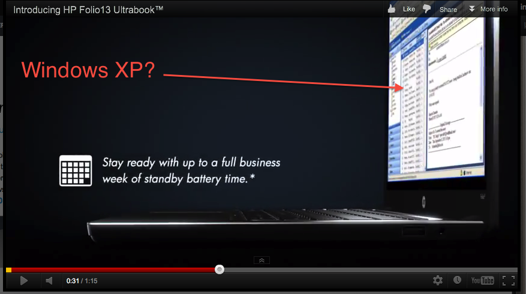

# A propaganda e o qualquer coisa

Não entendo de marketing, não entendo de propaganda. Mas entendo errado quando vejo algo que não faz sentido.

Se você criasse um produto com tecnologias atuais em uma época em que tudo o que mais se deseja pertence ao presente, você usaria uma imagem do passado para vender esse produto (a menos que a idéia seja usar o passado para vender o presente)? E se esse produto fosse um computador, um notebook... um ultrabook. Ultrabooks são novidade hoje em dia, principalmente porque devem ser leves, finos, resistentes e poderosos.

Dizem por aí que a propaganda é a alma do negócio, mas pode ser a arma também. Fiquei supreso de ver a tela abaixo:

 Edição de imagens não perspicaz - Windows XP?!

Você não esperaria ver uma tela do Windows 7 Professional (64 bits, de preferência) na propaganda?

Oxiii...
