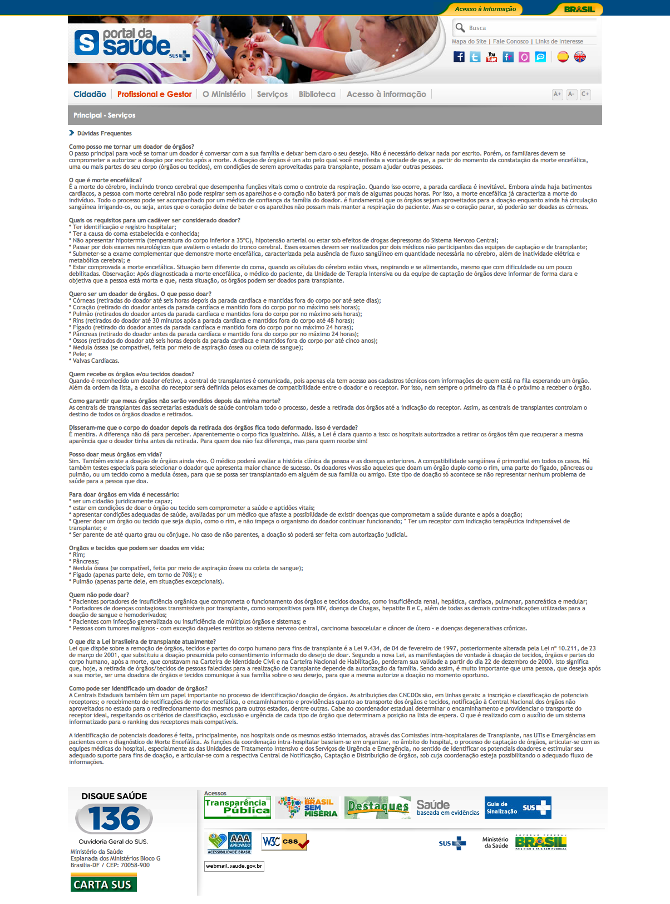

# Doação de órgãos

Eu sou doador de órgãos. Isso significa que quando eu morrer, minha família está autorizada a doar os meus órgãos para que outra(s) pessoa(s) possa(m) se beneficiar, tendo uma qualidade e expectativa de vida melhores.

Se você nunca pensou no assunto ou tem dúvidas sobre este gesto, saiba que o governo brasileiro criou o [Portal da Saúde](http://portalsaude.saude.gov.br/portalsaude/) em que várias informações a respeito do nosso sistema de saúde são dadas, inclusive uma seção de [Perguntas e Respostas sobre Doação de Órgãos](http://portal.saude.gov.br/portal/saude/visualizar_texto.cfm?idtxt=23628).

 Doação de órgãos: tire suas dúvidas.
