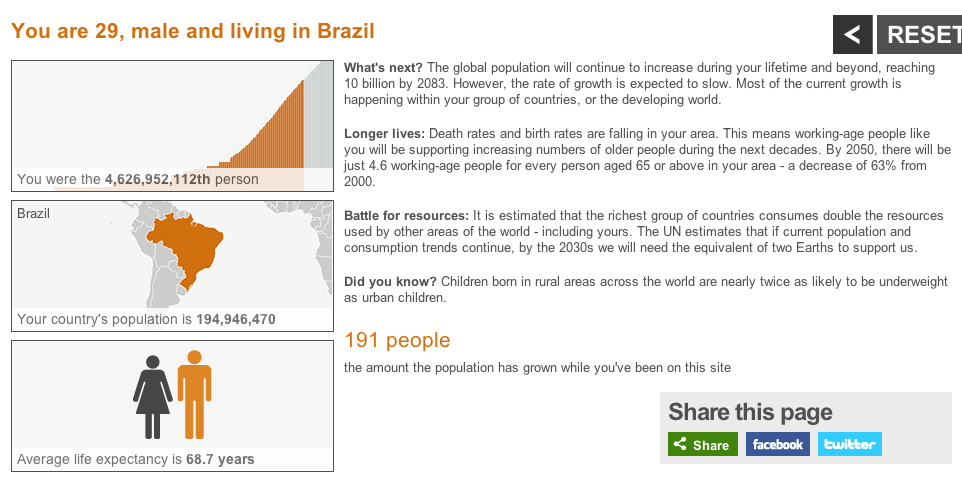

# Qual é a sua posição no mundo?

Hoje somos mais de 7 bilhões de pessoas no mundo. Você tem idéia de qual é a sua posição? O número da minha posição é 4.626.952.112. Para mim, este número é único (mesmo sendo uma estimativa), mas o interessante é que ele existe e cada cidadão do mundo deve ter o seu.

Descobri este número e mais outras informações bastante interessantes (e preocupantes também) sobre como a existência da minha geração e das gerações sucessoras irão influenciar a vida em nosso planeta. Para descobrir a sua posição no mundo, entre na página da BBC de Londres e veja o que o infográfico deles tem a lhe dizer!

Link: <http://www.bbc.co.uk/news/world-15391515>
 Qual é o seu número? Qual a sua expectativa de vida? Como será o seu futuro em termos de sobrevivência?

O mais interessante (e importante) é perceber que enquanto a população da Terra cresce numa escala logarítimica a partir da metade do século XVIII, a Terra não muda de tamanho, e os recursos naturais não devem se multiplicar, quer dizer, temos mais pessoas disputando pelos mesmos recursos de sobrevivência (água e comida, essencialmente) no mesmo espaço. Temos que pensar de forma econômica, preservando o meio ambiente para a nossa geração e para as gerações futuras. Além disso, temos que lidar com as disputas de poder, com a violência, com as ditaduras e com a ganância. Ser um pequenino grão de areia na imensidão desse universo (no qual o nosso planeta também é um grãozinho de areia), é antagônico perante aos desafios da nossa existência e responsabilidades...
