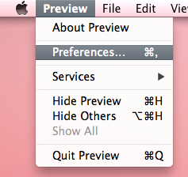
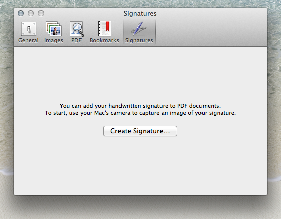
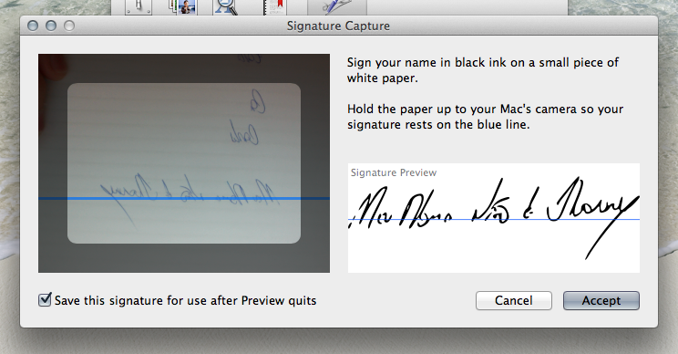
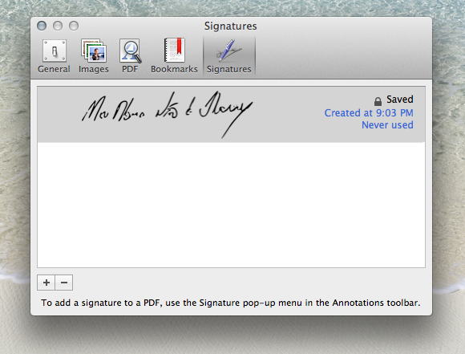
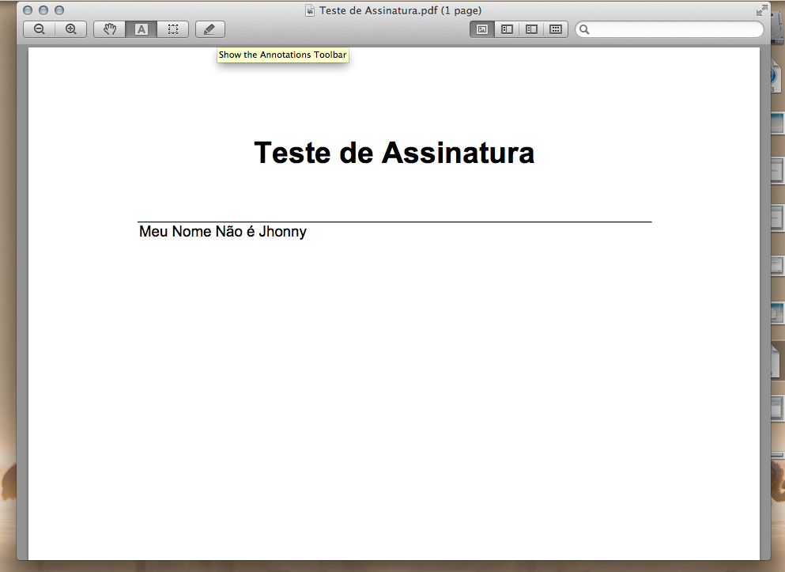
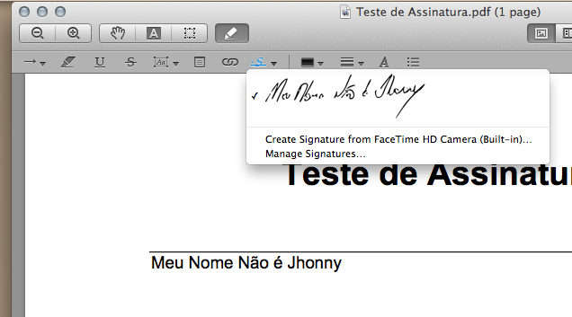
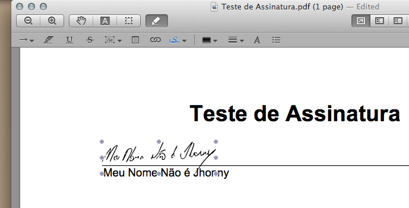

# Insira assinaturas digitalizadas em documentos PDF com o Preview no Mac OS X

O Preview é um programa "curinga" no Mac OS X. Ele serve para abrir desde arquivos de imagens em vários formatos a documentos PDF, e com direito à edição, tanto das imagens quanto dos arquivos PDF. Um recurso legal que ele tem é a possibilidade de se inserir assinaturas em documentos que você precisa assinar (desde que o destinatário aceite esse tipo de assinatura, certo ;) ). Para criar uma assinatura digital e incorporar em algum documento PDF, siga os passos abaixo.

1) Abra o Preview (você pode clicar no Spotlight e digitar Preview - é prático e rápido):

 Abrindo o Preview pelo Spotlight

Depois de aberto, o Preview não mostra nenhuma janela, apenas os menus na barra de menus.

2) Clique em Preview, Preferências:

 Abrindo as preferências do Preview

3) Na janela de preferências, clique na aba Assinaturas e depois no botão Criar Assinatura:

 Criar uma assinatura no Preview

4) Na janela seguinte, você vai digitalizar a sua assinatura. Escreva sua assinatura em um papel branco e com o auxílio da linha azul na tela, tente posicionar a sua assinatura para que a câmera do Mac OS X tire uma foto :)

 Digitalizando uma assinatura no Preview

Como você pode perceber, a assinatura ficará com a linha preta, portanto não importa a cor da tinta da caneta que você utilizar para escrever. Quando você conseguir enquadrar a sua assinatura e ela aparecer de forma satisfatória no espaço de visualização, clique no botão Aceitar.

Com isso, você criou uma assinatura digital, ou melhor, digitalizou uma assinatura no Preview e que pode ser usada em qualquer documento que possa ser aberto pelo Preview, principalmente documentos PDF. Essa é uma maneira muito simples e fácil de se digitalizar uma assinatura, muito mais rápido que utilizar um scanner!

 Assinatura digitalizada!

Agora vamos fazer um teste. Crie um documento qualquer (pode ser no Word ou no Pages) e salve em PDF. Vamos inserir a assinatura nele. Para isso, utilize o Preview para abrir o documento que você criou:

 Documento teste aberto no Preview

Na barra de ferramentas do Preview, observe um ícone com o desenho de um lápis (deve ser o último ícone), clique nele. Uma nova barrinha deverá se abrir na parte de baixo, clique no ícone que tem uma letra cursiva (em destaque azul na imagem abaixo):

 Inserindo a assinatura digitalizada

Selecione a assinatura que você quiser (caso você tenha feito outras) e posicione da forma como desejar:

 Posicionando a assinatura no documento

Depois disso, basta salvar e enviar para quem precisa ;)
