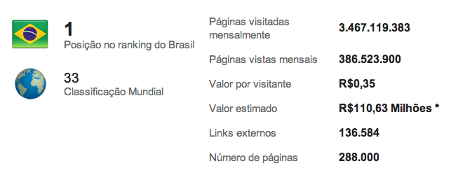
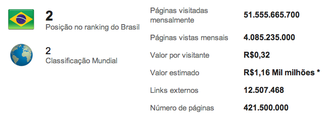
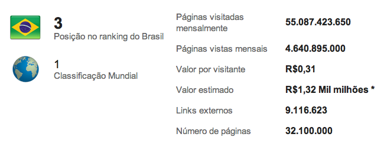
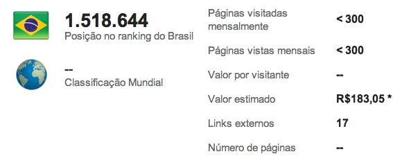

# Quanto vale o seu site/blog?

Você tem idéia de quanto vale o seu site/blog? No site [urlpulso.com.br](http://urlpulso.com.br), há uma estimativa. Basta colocar o endereço do seu site que ele mostra uma série de informações e estatísticas sobre o seu site, incluindo um estimativa de quanto ele vale e quanto cada visita rende. Se é verdade eu não sei, mas para testar o nexo das informações, fiz um ranking (válido para hoje e provavelmente para alguma média de longo termo). Você saberia dizer quais são os três sites mais visitados pelos brasileiros?

Lá vai:

**Primeiro Lugar: <www.google.com.br>**
 O Google... é o Google. É o mais acessado e ponto.

**Segundo Lugar: <www.facebook.com>**
 O Facebook é café com leite, não deveria contar...

**Terceiro Lugar: <www.google.com>**
 Eu já falei que o Google é o Google...

E este modesto blog? Será que vale alguma coisa??

**Primeiro milionésimo quingentésimo décimo oitavo milésimo seiscentésimo quadragésimo quarto lugar: [craftmind.wordpress.com](http://craftmind.wordpress.com)**

E a posição nem coube na mesma linha... :(

 Sal, sal, sal... preciso de SAL!!!!!

Vale, vale R$ 183,05 (cento e oitenta e três reais e cinco centavinhos). Se eu vendesse o meu blog agora, eu poderia comprar (com a ajuda de alguns centavos a mais):

1. Um alarme de carro [aqui](http://todaoferta.uol.com.br/comprar/alarme-positron-cyber-fx-3-anos-garantia-promocao-menorpreco-TMVWMWEU5C#rmcl)
2. Uma prestação de uma mota Yamaha YBR (mas teria que criar o meu blog mais 48 vezes, sem contar com a entrada...) [aqui](http://www.motofinanciada.com/)
3. Uma cesta básica em Aracajú [aqui](http://www.infonet.com.br/economia/ler.asp?id=115822&titulo=noticias)
4. Uma prestação de um refrigerador de duas portas [aqui](http://shopping.uol.com.br/promocao-bradesco.html?id=61191513&pagetp=3) ou [aqui](http://www.efacil.com.br/DetalheProduto.aspx?Codmer=2207595&Midia=15&utm_source=ShopUol&utm_medium=xml_Eletrodom%E9sticos&utm_content=Refrigeradores%20Frost%20Free_2207595&utm_campaign=0) (mas teria que recriar meu blog mais 12 vezes, pelo menos não teria entrada :) )

E por aí vai.

Com tudo isso, é melhor esperar mais um pouquinho, ir juntando umas moedinhas no porquinho e ir seguindo a vida :P
