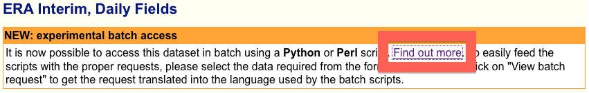
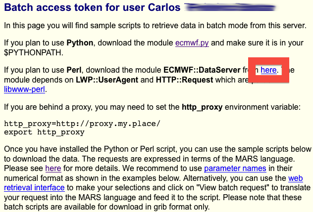
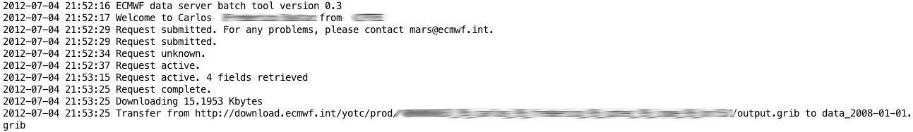

# Baixe a reanálise ERA Interim do ECMWF utilizando um script Perl

Recentemente precisei baixar alguns dados da Renálise do ERA Interim para estudo. No site, é oferecido um formulário onde pode-se selecionar o período, variáveis, níveis etc. Com essa seleção, um script server-side processa o seu pedido, gera um arquivo em GRIB e, dependendo do seu pedido, converte o GRIB em NETCDF. Perfeito! Mas e se você quiser baixar tudo? e uma quantidade colossal de dados e com certeza vai demandar uma quantidade colossal de espaço e tempo. Portanto, vamos considerar que você queira baixar um período grande, contendo alguns anos, níveis e variáveis, algo suficiente para que você queira e precise fazer um script.

O primeiro passo, portanto, é entrar em <http://data-portal.ecmwf.int/data/d/interim_daily/>e depois clicar no link indicado na imagem abaixo:

[](http://craftmind.wordpress.com/2012/07/04/baixe-a-reanalise-era-interim-do-ecmwf-utilizando-um-script-perl/screen-shot-2012-07-04-at-9-34-02-pm/)Você será redirecionado para uma nova página contendo um script simples em Python e outras duas opções em Perl, que são as opções que nós iremos usar.

[](http://craftmind.wordpress.com/2012/07/04/baixe-a-reanalise-era-interim-do-ecmwf-utilizando-um-script-perl/screen-shot-2012-07-04-at-9-42-42-pm/)Os scripts que nos interessam estão mais ao final da página. Mas para utilizá-los, nós necessitaremos de alguns softwares instalados no computador. Vamos precisar do Perl (uma linguagem de programação em scripts modular) e de dois módulos básicos: o libdate-calc-perl e o DataServer do ECMWF que deve ser baixado no link indicado pelo retângulo vermelho da imagem acima.

Para instalar estes pacotes no seu Linux (vou considerar o Ubuntu), faça o seguinte:

**1) Instale o Perl:**


```
$ sudo apt-get install perl
```


**2) Instale o módulo libdate-calc-perl:**


```
$ sudo apt-get install libdate-calc-perl
```


**3) Baixe o módulo DataServer do ECMWF em <http://tigge.ecmwf.int/ECMWF_DataServer.tar>**

**4) Desempacote o arquivo [ECMWF_DataServer.tar](http://tigge.ecmwf.int/ECMWF_DataServer.tar) na pasta /usr/share/perl/<versao_do_seu_perl>:**


```
$ sudo tar -xvf ECMWF_DataServer.tar -C /usr/share/perl/<versao_do_seu_perl>
```


Se você estiver utilizando o Mac OS X (vou considerar o Lion), você precisará apenas instalar o módulo DataServer do ECMWF na pasta /System/Library/Perl/5.12:


```
$ sudo tar -xvf ECMWF_DataServer.tar -C /System/Library/Perl/5.12
```


Feito isto, copie o segundo script em Perl (é o último script da página) da página que você abriu (a página que contém os scripts) e cole em um arquivo vazio no seu computador:


```
#!/usr/bin/perl -Ipath_to_where_ECMWF::DataServer_is_installed
use ECMWF::DataServer;
use Date::Calc qw(Add_Delta_Days Delta_Days);
use strict;

my $client = ECMWF::DataServer->new(
    portal => 'http://data-portal.ecmwf.int/data/d/dataserver/',
    token  => 'xxxxxxxxxxxxxxxxxxxxxxxxxxxxx',
    email  => 'yyyyyyyyyyyyyyyyyyyyyyyyyyyyy',
);

# This is the start date. Modify as required
my ($year, $month, $day) = (2009, 01, 01);
# This is the end date. Modify as required
my @enddate = (2009, 01, 02);

while (Delta_Days(@date, @enddate) >= 0) {

  my $date = sprintf("%d-%02d-%02d", $year, $month, $day);

  $client->retrieve( 
    dataset  => "interim_daily",
    step     => "0",
    levtype  => "pl",
    type     => "an",
    param    => "130.128",
    levelist => "500/1000",
    area     => "60/-120/30/-60",
    date     => "$date",
    time     => "00/12",
    target   => "data_${date}.grib",
    );

  # move to next day
  ($year, $month, $day) = Add_Delta_Days($year, $month, $day, 1);

}
```


Para este script, devem ser observadas as sequências 'xxxxxx...' e 'yyyyy...' para as variáveis "token" e "email", respectivamente. Estas são variáveis utilizadas pelo módulo DataServer do ECMWF para autenticar a sua conexão ao servidor do centro. Quando você abrir esta página, será gerada automaticamente um token (uma espécie de senha) específica para o email que você forneceu anteriormente. Portanto, esses 'yyyyy...' e esses 'xxxxx...' não aparecem na página, mas sim o seu email (que você de ter informado) e um token gerado automaticamente. Uma outra informação importante, é que para executar corretamente o script, você precisar corrigir uma falha. Veja:


```
$ ./script_perl.pl
Global symbol "@date" requires explicit package name at ./script_perl.pl line 17.
Execution of ./script_perl.pl aborted due to compilation errors.
```


Ou seja, a variável "@date" é usada, mas não está declarada. Então, para consertarmos isso, basta acrescentar a linha em negrito abaixo dentro do seu script:


```
my ($year, $month, $day) = (2009, 01, 01);
my @date = (2009, 01, 01);
```


Com isso, será possível executar novamente o script e baixar os seus dados. Você pode alterar o script de acordo com as suas necessidades, bastando seguir a sintaxe do [MARS](http://www.ecmwf.int/services/archive/), que é um programa com linguagem própria criado para coletar os dados dentro do banco de dados do ECMWF.

O script corrigido fica assim:


```
#!/usr/bin/perl -Ipath_to_where_ECMWF::DataServer_is_installed
use ECMWF::DataServer;
use Date::Calc qw(Add_Delta_Days Delta_Days);
use strict;

my $client = ECMWF::DataServer->new(
    portal => 'http://data-portal.ecmwf.int/data/d/dataserver/',
    token  => 'xxxxxxxxxxxxxxxxxxxxxxxxxxxxx',
    email  => 'yyyyyyyyyyyyyyyyyyyyyyyyyyyyy',
);

# This is the start date. Modify as required
my ($year, $month, $day) = (2009, 01, 01);
my @date = (2009, 01, 01);
# This is the end date. Modify as required
my @enddate = (2009, 01, 02);

while (Delta_Days(@date, @enddate) >= 0) {

  my $date = sprintf("%d-%02d-%02d", $year, $month, $day);

  $client->retrieve( 
    dataset  => "interim_daily",
    step     => "0",
    levtype  => "pl",
    type     => "an",
    param    => "130.128",
    levelist => "500/1000",
    area     => "60/-120/30/-60",
    date     => "$date",
    time     => "00/12",
    target   => "data_${date}.grib",
    );

  # move to next day
  ($year, $month, $day) = Add_Delta_Days($year, $month, $day, 1);

}
```


Com tudo corrigido, o script mostra as seguintes saídas:

[](http://craftmind.wordpress.com/2012/07/04/baixe-a-reanalise-era-interim-do-ecmwf-utilizando-um-script-perl/screen-shot-2012-07-04-at-10-10-42-pm/) (Clique para ampliar)


Em meus testes, notei que o servidor do ECMWF é um pouco instável, portanto você poderá experimentar alguns "Connection Timeout", por parte do módulo DataServer do ECMWF, responsável pela autenticação da conexão entre o seu computador e o servidor do ECMWF.


```
500 read timeout at ECMWF/DataServer.pm line 35.
```


É isso!
