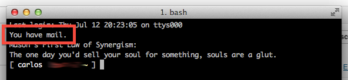
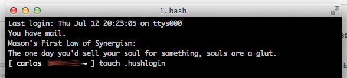
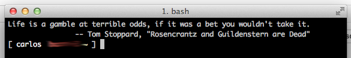

# Hush Terminal: You DO NOT have mail!

Sabe aquela mensagem "You have mail." quando você loga no terminal? Então, ela é uma mensagem do login do shell. Para fazer com que o terminal fique "calado", basta criar o arquivo ".hushlogin" no seu home:


```
$ cd
$ touch .hushlogin
```


E reiniciar o terminal. Veja:

[](http://craftmind.wordpress.com/2012/07/12/hush-terminal-you-do-not-have-mail/screen-shot-2012-07-12-at-8-25-48-pm/) You have mail. Huh...

[](http://craftmind.wordpress.com/2012/07/12/hush-terminal-you-do-not-have-mail/screen-shot-2012-07-12-at-8-26-11-pm/) Hush terminal!

[](http://craftmind.wordpress.com/2012/07/12/hush-terminal-you-do-not-have-mail/screen-shot-2012-07-12-at-8-26-28-pm/) Reiniciando e... Tadá!


**Referência:**

<https://discussions.apple.com/thread/604975?start=0&tstart=0>
