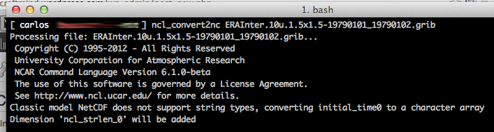

# Converta arquivos em GRIB para NetCDF com o NCL

Essa é rápida:

Para converter um arquivo em GRIB para NetCDF utilizando o NCL (para a instalação no Mac OS X Lion, [clique aqui](ncarg-no-mac-os-x-wp-1713.md)), basta fazer:


```
$ ncl_convert2nc arquivo.grib
```


Exemplo:

[](http://craftmind.wordpress.com/2012/07/13/converta-grib-em-netcdf-com-o-ncl/screen-shot-2012-07-13-at-12-32-47-am/)Neste exemplo, utilizamos o arquivo "ERAInter.10u.1.5x1.5-19790101_19790102.grib" (um arquivo GRIB comum) para gerarmos o arquivo "ERAInter.10u.1.5x1.5-19790101_19790102.nc", um arquivo NetCDF. Ambos podem ser abertos no GrADS, sendo que o GRIB precisa de um arquivo descritor (ctl) e o NetCDF não, pois ele contém um cabeçalho com as informações que estão no ctl do GRIB.

Para abrir o NetCDF no GrADS (versão 2.0+):


```
$ grads -blc "sdfopen arquivo.nc"
```


Para abrir o GRIB no GrADS (versão 2.0+):


```
$ grads -blc "open arquivo.ctl"
```


É isso!

PS.: Para fazer o contrário, ou seja, converter de NetCDF para GRIB, [clique aqui](converta-arquivos-em-netcdf-para-grib-com-o-cdo-wp-1727.md).
