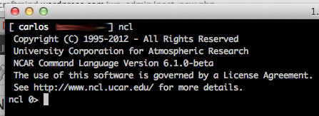

# NCARG/NCL no Mac OS X

O [NCARG](http://ngwww.ucar.edu/) é um poderoso software de visualização de arquivos em ponto de grade (GRIB, NetCDF, HDF) com linguagem própria. Para instalá-lo no Mac OS X, você tem duas alternativas:

1. Utilizando o port do Mac OS X pela linha de comando
2. Baixando o pacote de binários pré-compilados no site do [Earth System Grid](http://www.earthsystemgrid.org/home.htm)

Na primeia opção, obtive o seguinte erro:


```
$ sudo port install ncarg
 Password:
 --->  Computing dependencies for ncarg
 --->  Dependencies to be installed: hdfeos hdfeos5 lesstif xorg-libXp xorg-printproto triangle vis5d mesa xorg-dri2proto xorg-glproto tcl
 --->  Configuring hdfeos
 Error: org.macports.configure for port hdfeos returned: configure failure: command execution failed
 Error: Failed to install hdfeos
 Please see the log file for port hdfeos for details:
 /opt/local/var/macports/logs/_opt_local_var_macports_sources_rsync.macports.org_release_tarballs_ports_science_hdfeos/hdfeos/main.log
 Error: The following dependencies were not installed: hdfeos hdfeos5 lesstif xorg-libXp xorg-printproto triangle vis5d mesa xorg-dri2proto xorg-glproto tcl
 To report a bug, follow the instructions in the guide:
 http://guide.macports.org/#project.tickets
 Error: Processing of port ncarg failed
```


Ou seja, entre várias outras dependências que precisam ser instaladas, o programa hdfeos não pode ser corretamente configurado para compilação porque o script de configuração tenta utilizar o programa szip para a compilação e não consegue encontrá-lo:


```
$ more /opt/local/var/macports/logs/_opt_local_var_macports_sources_rsync.macports.org_release_tarballs_ports_science_hdfeos/hdfeos/main.log
info:configure configure: error: HDF4 was linked without SZIP, but --with-szlib was given
:info:configure Command failed:  cd "/opt/local/var/macports/build/_opt_local_var_macports_sources_rsync.macports.org_release_tarballs_ports_science_hdfeos/hdfeos/work/hdfeos" && ./configure --prefix=/opt/local --with-hdf4=/opt/local --with-zlib=/opt/local --with-szlib=/opt/local --disable-dependency-tracking 
:info:configure Exit code: 1
```


Por isto, vamos utilizar a segunda opção, que é baixar o pacote com os binários pré-compilados para o Mac OS X. No meu caso, estou no Mac OS X Lion com gcc 4.2.1. Para baixar o arquivo com os executáveis, antes você irá precisar de uma [OpenID](http://openid.net/get-an-openid/) e uma senha para poder logar no site do Earth System Grid e baixar o seguinte pacote:

- [ncl_ncarg-6.1.0-beta.MacOS_10.7_x86_64_gcc421.tar.gz](http://www.earthsystemgrid.org/browse/viewCollectionFilesLicenseAgreement.htm?datasetId=e358a0ab-a84d-11e1-86fa-00c0f03d5b7c)

Com o pacote já baixado, vamos às etapas de instalação:

**1) Crie uma pasta para o NCARG em /opt (pode ser em outro local, mas adapte as etapas seguintes):**


```
$ sudo mkdir -p /opt/ncl_ncarg-6.1.0-beta
```


**2) Desempacote o pacote baixado na pasta criada:**


```
$ sudo tar -zxvf ncl_ncarg-6.1.0-beta.MacOS_10.7_x86_64_gcc421.tar.gz -C /opt/ncl_ncarg-6.1.0-beta
```


**3) Inclua as seguintes variáveis de ambiente no seu .bash_profile (caso não tenha um, basta criá-lo):**


```
export NCARG_ROOT="/opt/ncl-ncarg-6.1.0-beta"
export NDV_COLORMAP_PATH="${NCARG_ROOT}/lib/ncarg/colormaps"
export PATH="${NCARG_ROOT}/bin":${PATH}
export C_INCLUDE_PATH="${NCARG_ROOT}/include":${C_INCLUDE_PATH}
export LIBRARY_PATH="${NCARG_ROOT}/lib":${LIBRARY_PATH}
```


Feito isto, basta reabrir o terminal e executar o ncl:

[](http://craftmind.wordpress.com/2012/07/13/ncarg-no-mac-os-x/screen-shot-2012-07-13-at-12-20-15-am-2/) NCARG/NCL no Mac OS X Lion!
