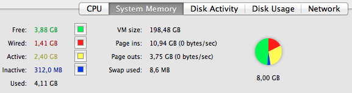
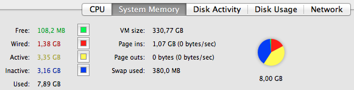
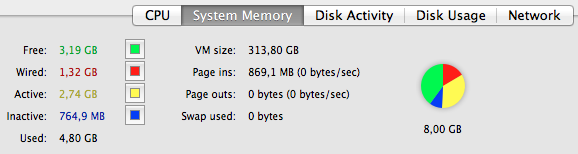
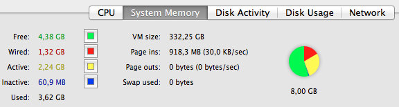

# OS X Mountain Lion: vale a pena!

Há alguns meses atrás comprei um macbook pro de 13'' com 4GB de memória RAM e com Mac OS X Lion. Nos primeiros dias de utilização, não pude deixar de esconder uma certa desconfiança em relação do Mac OS X Lion, pois este não apresentava o desempenho que eu esperava. Por duas vezes, o macbook travou em situações em que vários programas estavam abertos; em outras situações (mais comuns) me irritava a lentidão de algumas animações do sistema e a beach ball of death (quando o aquele cursor colorido de espera fica girando indefinidamente esperando algum programa responder). Isso me irritou bastante, e percebi que os 4GB de RAM do macbook não eram suficientes. Resolvi colocar 8GB de RAM no macbook e ver se conseguiria um pouco mais de fôlego. O desempenho melhorou bastante, mas os pageouts continuaram e alguns programas ainda eram lentos, o que pude comprovar com a quantidade de pageouts que havia no sistema, mesmo com memória RAM de sobra:

[](http://craftmind.wordpress.com/2012/08/07/os-x-mountain-lion-vale-a-pena/screen-shot-2012-08-05-at-1-15-10-pm/) Pageouts excessivos no Mac OS X Lion: gerenciamento de memória ruim...

Com o lançamento dos previews do OS X Mountain Lion, fui acompanhando o depoimentos de quem estava testando e o consenso era de que a nova versão do Mac OS X - ou melhor OS X, já estava mais estável em termos de gerenciamento de memória. Fiz o upgrade - um tanto quanto receoso pois tratava-se de uma versão recém-lançada e eis minha surpresa:

[](http://craftmind.wordpress.com/2012/08/07/os-x-mountain-lion-vale-a-pena/screen-shot-2012-08-01-at-7-12-55-pm/) Sem pageouts no OS X Mountain Lion: enquanto tem memória RAM disponível, nada de lentidão no sistema!

Com o OS X Mountain Lion, meu macbook pro ficou bastante rápido e confiável, uma vez que não enfrento mais lentidões por conta dos excessivos pageouts que o Mac OS X Lion insistia em criar. Memória RAM tem que ser usada, até o último byte; se o sistema operacional não consegue utilizar de forma eficiente os seus 2, 4, 6 ou 8GB que você tem, o investimento não vale à pena!

Ok, com as declarações acima, dá pra ver que o OS X Mountain Lion é mais eficiente no gerenciamento de memória, mas o que o page out realmente representa?

Segundo as informações da Apple (neste [link](http://support.apple.com/kb/HT1342?viewlocale=en_US&locale=en_US)), as funções de cada um desses elementos é a seguinte:

- **VM size**: é a quantidade total de memória virtual para todos os processos executados no Mac OS
- **Page out**: é a quantidade de informação que saiu da memória RAM e foi para o disco rígido (quanto mais, pior)
- **Page in**: é a quantidade de informação que sai do disco rígido e volta para a memória RAM, quando a memória antes ocupada, é liberada
- **Swap used**: é a quantidade de informação copiada para o arquivo de paginação (swap file) no disco rígido

Além disso, outras informações que o monitor de atividades do Mac OS fornece em relação ao uso da memória RAM, são:

- **Free**: é a quantidade de memória RAM que não está sendo utilizada
- **Wired**: é quantidade de memória RAM que está sendo utiliza e que não pode ser movida para o disco rígido (este valor depende dos programas que estão abertos)
- **Active**: é a quantidade de memória RAM recentemente utilizada
- **Inactive**: semelhante a active, é a quantidade de memória RAM que foi recentemente utilizada mas que ainda não foi liberada
- **Used**: é a quantidade total de memória RAM utilizada pelo Mac OS

**Comandos úteis:**

Caso seja necessário forçar a liberação da memória "inativa" do Mac OS, você pode utilizar o comando purge. Para isso, basta abrir o terminal do Mac OS X e digitar:


```
$ purge
```


~~*No OS X 10.8.1 este comando está com um bug (na verdade você não consegue executá-lo, obtendo a seguinte mensagem:~~


```
[ERROR] <CPPathUtils.c:526> The device-file for this operating system, 'osx-12.1.0.xml', was not found. An attempt to revert to a previous revision of the OS device-file: 'osx-12.0.0.xml' has been made. Please file a Radar report with Apple, on the 'CoreProfile' component, version 'X'.
```


*O problema acima já foi resolvido e o comando purge funciona sem problemas no OS X 10.8.2.

Depois que o comando purge for executado, alguns programas podem ficar mais lentos na inicialização, pois terão sido removidos da memória RAM.

Exemplo de um antes e depois do comando purge:

[](http://craftmind.wordpress.com/2012/08/07/os-x-mountain-lion-vale-a-pena/screen-shot-2012-08-07-at-9-34-38-pm/) Antes de rodar o comando purge: observe a quantidade de memória inativa (inactive, em azul) utilizada

[](http://craftmind.wordpress.com/2012/08/07/os-x-mountain-lion-vale-a-pena/screen-shot-2012-08-07-at-9-36-14-pm/) Depois de rodar o comando purge, a quantidade de memória inativa (em azul) é liberada

Outro comando útil, mas para o monitoramento da memória RAM, é o comando vm_stat. Para utilizá-lo, basta abrir o terminal e digitar:


```
$ vm_stat
```


Para fazer com que o comando seja atualizado automaticamente, digamos, a cada 3 segundos, basta fazer:


```
$ vm_stat 3
```


e assim por diante.

**Referências:**

- <http://support.apple.com/kb/HT1342?viewlocale=en_US&locale=en_US>
- <http://macintoshhowto.com/hardware/does-my-mac-need-more-memory.html>
- <http://osxdaily.com/2010/10/29/does-your-mac-need-more-memory-how-to-know-if-you-need-a-ram-upgrade/>
- <http://osxdaily.com/2007/05/16/quickly-check-mac-os-xs-virtual-memory-usage/>
- <http://osxdaily.com/2010/10/08/mac-virtual-memory-swap/>
