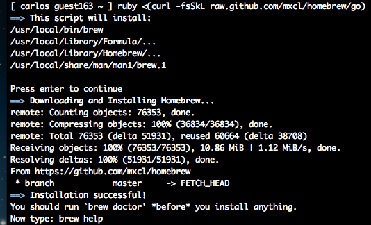
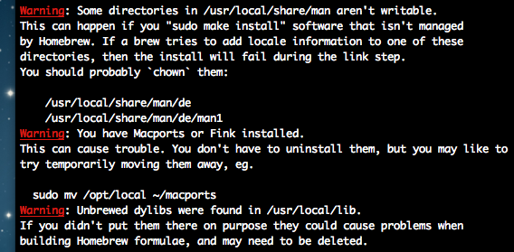

# Removendo o MacPorts e instalando o HomeBrew no Mac OS X

O MacPorts e o HomeBrew são gerenciadores de pacotes em linha de comando para o Mac OS X no mesmo estilo do apt-get para os sistemas baseados no Debian, ou o yum no Fedora, zipper no OpenSuse, emerge no Gentoo, swaret ou gslapt no Slackware etc :)

Quando comecei a fuçar no Mac OS, senti falta de um gerenciador de pacotes tal como o apt-get, que resolve facilmente as dependências dos pacotes e facilita imensamente o trabalho de se instalar programas no Linux. Depois de procurar um pouco acabei encontrando quatro opções:

- [Fink](http://www.finkproject.org)
- [Rudix](http://rudix.org)
- [HomeBrew](http://mxcl.github.com/homebrew/)
- [MacPorts](http://www.macports.org)

Cada um desses programas tem suas características no tratamento das dependências dos pacotes e na forma de baixar, configurar e compilar; além disso, alguns são mais simples - como Rudix (que é dos brasileiros [Rudá Moura](http://rudamoura.com) e Leonardo Santagada), que já traz os pacotes pré-compilados e instala apenas os executáveis e outros mais sofisticados - como o MacPorts, o Fink e o HomeBrew. O MacPorts, por exemplo, é baseado no Ports do FreeBSD e é mantido com o apoio voluntário de alguns desenvolvedores da Apple - o que é bastante interessante, e recebe muitas contribuições dos usuários e tem uma biblioteca de programas bastante completa sendo (em minha opinião) a base de programas-fonte mais completa disponível para o Mac OS X.

Este artigo, no entando, tratará especificamente sobre a remoção do MacPorts (para um guia de instalação, clique [aqui](http://www.macports.org/install.php) - em inglês) e a instalação do HomeBrew. Estou fazendo isso porque nos últimos tempos tenho encontrado alguns problemas de atualização do MacPorts e para não ficar muito tempo com o mesmo problema nas mãos, resolvi testar o HomeBrew para o gerenciamento dos programas que preciso instalar.

Antes de mais nada, é importante que você saiba que os procedimentos que vou tomar neste tutorial, irão remover completamente TODOS os pacotes que você instalou através do MacPorts, incluindo o próprio MacPorts. Além disso, algum programa que você tenha instalado sem utilizar o MacPorts e que utilize alguma biblioteca dinâmica instalada através dele, poderá deixar de funcionar. Então, você pode utilizar este tutorial apenas como uma última tentativa para resolver algum eventual problema. Faça por sua própria conta e risco!

**Removendo o MacPorts**

Para remover o MacPorts por completo, utilizaremos dois comandos, realizando a desinstalação em duas etapas:

1. Removendo os pacotes que foram instalados: talvez você queira apenas "resetar" o MacPorts, removendo todos os pacotes instalados mas mantendo a instalação do MacPorts no seu Mac OS;
2. Removendo a instalação do MacPorts: aí sim tudo o que o MacPorts tem será removido, incluindo os pacotes;

Para remover os pacotes instalados através do MacPorts, utilize o comando:


```
$ sudo port -fp uninstall installed
```


Com isso, os pacotes que você baixou pelo MacPorts (exemplo, sudo port install wget) serão removidos. Dependendo da quantidade de pacotes instalados, esta operação poderá demorar um pouco.

Para remover todo o MacPorts (e tudo que veio junto com ele), utilize o comando:


```
$ sudo rm -rf \
/opt/local \
/Applications/DarwinPorts \
/Applications/MacPorts \
/Library/LaunchDaemons/org.macports.* \
/Library/Receipts/DarwinPorts*.pkg \
/Library/Receipts/MacPorts*.pkg \
/Library/StartupItems/DarwinPortsStartup \
/Library/Tcl/darwinports1.0 \
/Library/Tcl/macports1.0 \
~/.macports
```


Depois disso, bye-bye MacPorts! Se o seu objetivo era remover o MacPorts, pode parar por aqui. Se quiser instalar o HomeBrew, basta seguir as instruções abaixo.

**Instalando o HomeBrew**

O HomeBrew, em comparação com o MacPorts, é mais espartano para instalar: ele não tem um instalador e tudo é feito via linha de comando. Na verdade ele tem um script de instalação que está disponível no GitHub. Para instalar, execute o comando no terminal (lembrando que para isto, você precisa do XCode Command Line Tools para ter acesso ao git, ruby, subversion etc):


```
$ ruby <(curl -fsSkL raw.github.com/mxcl/homebrew/go)
```


[](http://craftmind.wordpress.com/2012/08/14/removendo-o-macports-e-instalando-o-brew-no-mac-os-x/screen-shot-2012-08-14-at-6-50-07-pm-2/) Instalação do HomeBrew: simples e rápida

É só isso, bem fácil e rápido. O complicado, vem depois.

Depois de baixar e instalar o HomeBrew, é ALTAMENTE recomendado executar o comando "brew doctor" antes mesmo de atualizar a base de dados do brew e instalar qualquer programa. O HomeBrew não utiliza o sudo para obter permissão de escrita em determinadas áreas do sistema; você pode utilizar fazer um "brew install wget" sem precisar ser root ou usar o sudo. Isso significa que ele escreve em áreas reservadas do sistema sem misturar os binários nativos do shell do Mac OS com os binários que você irá criar com a instalação de programas; além disso, ao invés de copiar os executáveis criados na compilação dos programas, ele apenas cria links simbólicos. Isso é um vantagem quando se quer manter o sistema saudável e minimamente organizado. Por isso é tão importante executar o "brew doctor" antes de mais nada:


```
$ brew doctor
```


Com isso, o "Doctor Brew" irá apontar uma série de problemas (principalmente de permissões) que você deve resolver antes de começar a usar o HomeBrew. Por exemplo:

[](http://craftmind.wordpress.com/2012/08/14/removendo-o-macports-e-instalando-o-brew-no-mac-os-x/screen-shot-2012-08-14-at-6-53-41-pm/) Doutor Brew em ação: organizando o sistema

É bastante importante alientar que nesta situação cada um pode ter problemas diferentes apontados pelo "brew doctor". No meu caso houve vários, mas eu pude resolver todos. Nos casos em que é necessário alterar a permissão como sugerido pela mensagem "You should probably `chown` them", você poderá usar o seguindo comando:


```
$ sudo chow -R carlos /usr/local/share/man/*
```


Isso fará com que o usuário "carlos" se torne dono da pasta "man" em "/usr/local/share" e das pastas que estiverem dentro de "man" - este comando será executado recursivamente.

A menos que você tente resolver todos os problemas de uma só vez (se for possível), e importante que você execute o comando "brew doctor" novamente depois de tentar resolver o problema indicado, para ter certeza de que tudo está sendo resolvido. Tome muito cuidado com as bibliotecas dinâmicas - você pode apagá-las (o que não é uma boa idéia, a menos que você saiba o que está fazendo), pois com certeza irá estragar a instalação de algum outro programa. Por exemplo, no meu caso, eu havia instalado o programa ncargs (NCAR Graphics) no Mac OS X sem utilizar o MacPorts, mas alguns executáveis dele foram lincados com algumas bibliotecas dinâmicas do gfortran, que foi instalado pelo MacPorts. Resultado, o comando "ncl" do programa ncargs não funciona mais. Portanto, tome muito cuidado!!!

Outro ponto importante, é a configuração do seu PATH: talvez você tenha que adicionar dois caminhos utilizados pelo HomeBrew a ele. Por exemplo, no meu ".bas_profile" (que fica oculto no meu home), na última linha do arquivo eu adicionei o seguinte:


```
export PATH="/usr/local/sbin":${PATH}
export PATH="/usr/local/bin":${PATH}
```


Depois disso, basta salvar e fechar o arquivo e recarregar as variáveis de ambiente do seu shell:


```
$ source .bash_profile
```


Isso poderá auxiliar na solução dos problemas apontados pelo "brew doctor".

Quando todos os problemas forem resolvidos, o "brew doctor" exibirá a seguinte mensagem:


```
Your system is raring to brew.
```


Com isso, tudo está pronto para o primeiro update e depois para a instalação dos seus programas. Para fazer o primeiro update, basta fazer:


```
$ brew update
```


E depois, se tudo der certo :P instale os programas que você precisar. Por exemplo, instale o programa wget:


```
$ brew install wget
```


Isso é tudo, se precisar de mais ajuda, basta digitar "brew --help" no terminal. Ah, o termo "FORMULA" utilizado pelo HomeBrew se refere a uma rotina para a instalação de algum programa. Portanto, se você digitar "brew install wget", wget será o nome da FORMULA que você estará utilizando para instalar o pacote wget-1.14.tar.gz.

Apenas como curiosidade, o termo "HomeBrew" é utilizado para alguma coisa caseira, feita em casa.

**Referências:**

- <http://guide.macports.org/#installing.macports.uninstalling>
- <http://mxcl.github.com/homebrew/>
- <http://pedromenezes.com/conheca-o-homebrew-o-melhor-gerenciador-de-pacotes-para-mac-os>
- <http://pt.wikipedia.org/wiki/Homebrew>
