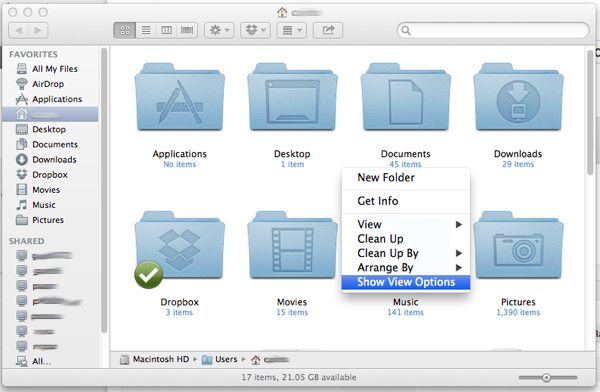
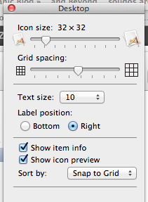
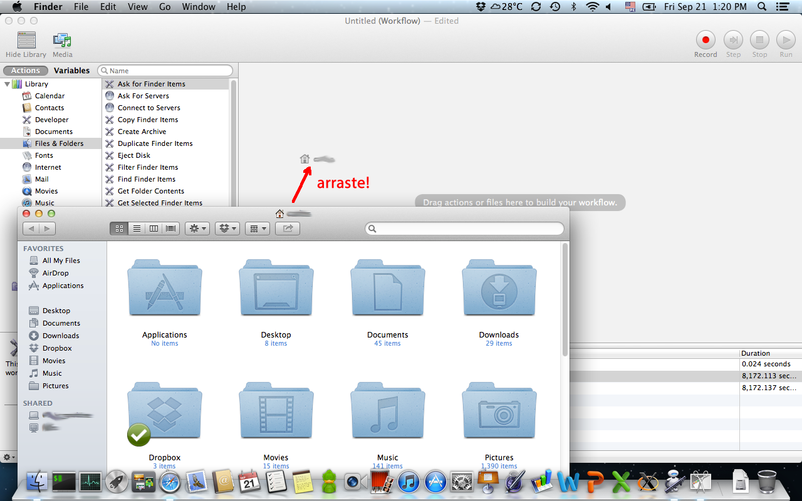
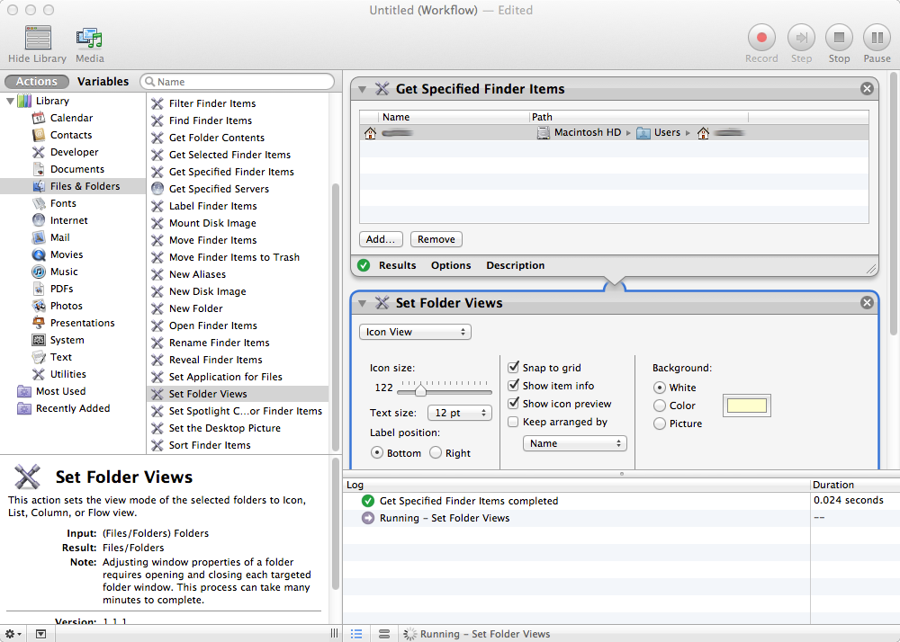

# Ajustando as propriedades de visualização de todas as pastas no Finder utilizando o Automator

Título grande, né?

No Finder (gerenciador de arquivos do Mac OS) é possível ajustar as propriedades de visualização dos arquivos para a pasta atual, mas não para todas as pastas que você tiver. Isso é um problema, pois no não há uma opção para fazer com que todas as pastas tenham o mesmos tipo de visualização por padrão. Porém, isso é perfeitamente possível com o Automator, que é um software do próprio Mac OS X para automatizar algumas tarefas do sistema, entre elas, a forma como as pastas são visualizadas no Finder.

Vamos ao passo a passo:

**1) Abra uma pasta (de preferência o seu Home), clique com o botão direito (se estiver utilizando um mouse) ou com dois dedos no trackpad e selecione a opção "Show View Options" (ou Mostrar opções de visualização):**
 Ajuste inicial das configurações de visualização de pastas no Finder

**2) Na janelinha que se abrir, ajuste as preferências da forma como quer que todas as pastas sejam mostradas (lembrando que é possível fazer com que outras pastas - como a pasta de imagens, sejam mostradas de outra forma):**
 Ajuste das preferências de visualização

**3) Abra o Automator - ele está na pasta "Applications" (ou Aplicativos):**
 Automator :)

**4) Arraste a pasta com as opções de visualização que você ajustou para o painel direito do Automator:**
 Arraste a pasta para dentro do workflow

**5) No próprio Automator, selecione (no painel da esquerda) o item "Files & Folders" (ou Arquivos e Pastas), no submenu que aparecer no painel do meio, clique e arraste o item "Set Folder Views" (ou Ajustar Visualização de Pastas) para o painel da direita, logo abaixo da pasta que você havia arrastado anteriormente com as configurações que você ajustou:**
 Executando a tarefa no Automator

**6) Reveja as opções, ajuste o que precisar e clique no botão "Run"(ou Executar) na janela do Automator:**
 Pressione o botão "Run" (ou Executar)

Feito isso, o Automator irá executar as configurações escolhidas para todas as pastas do Finder. Isso poderá demorar um certo tempo, dependendo da quantidades de pastas e arquivos que você tiver em seu computador.

**Referência:**

- <http://macs.about.com/od/usingyourmac/ss/Setting-Finder-Views-For-Folders-And-Sub-Folders_4.htm>
- <http://macosxautomation.com/automator/index.html>
