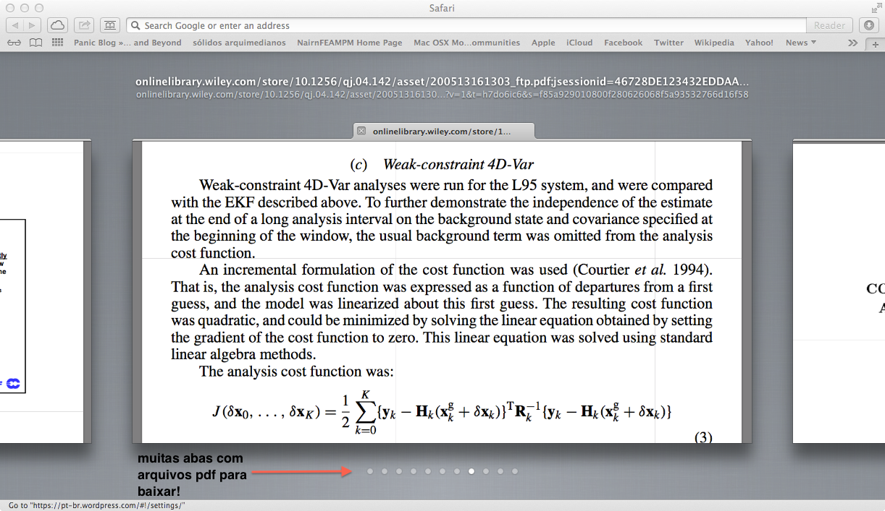
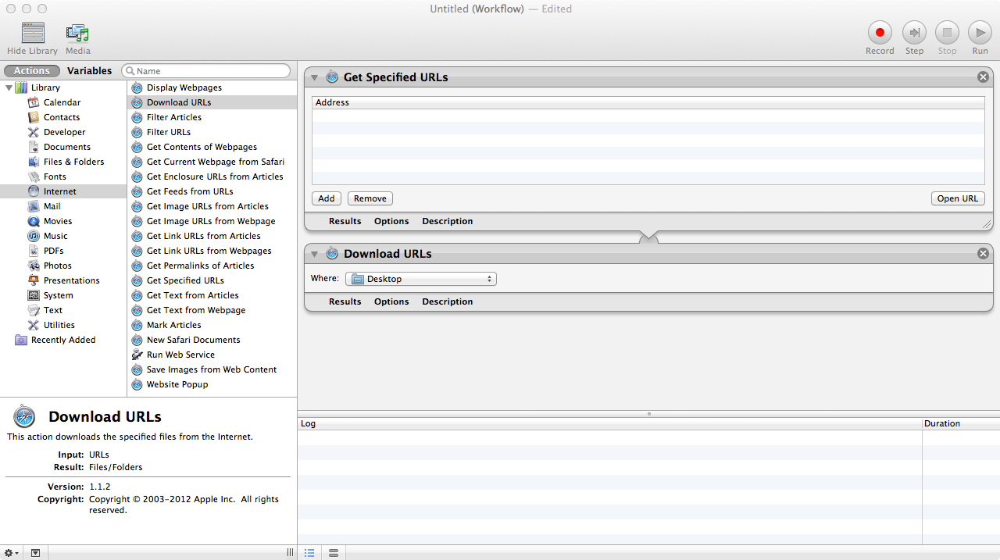
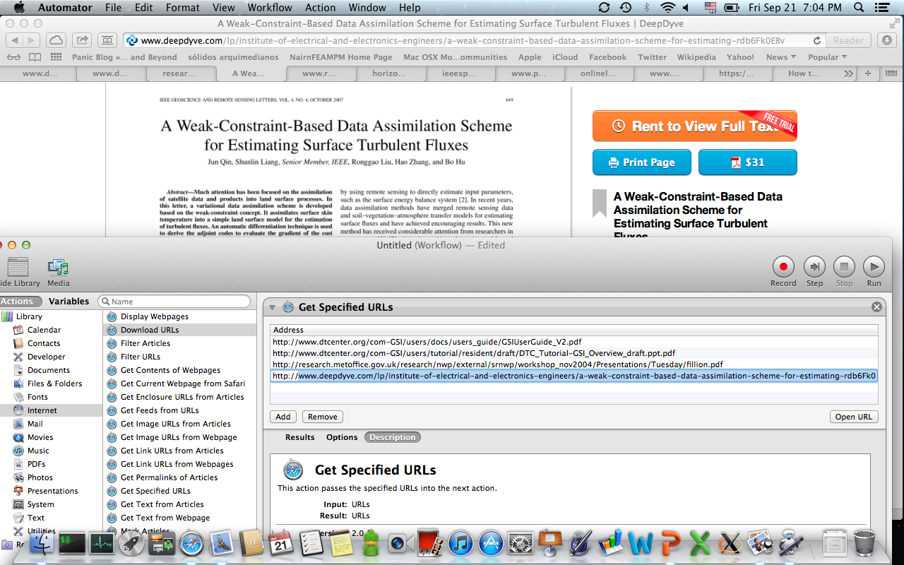

# Utilizando o Automator para baixar arquivos PDF abertos no Safari

Sabe quando você está pesquisando no google e vai abrindo um monte de abas com arquivos PDF e no final quer salvar tudo? Se você abrir muitas abas, então terá que repetir o processo de salvar os arquivos muitas vezes. Ao invés de fazer isso, você pode usar o Automator para baixar tudo!

Eis a situação:

 Abas com os arquivos PDF para salver

Vamos utilizar o Automator para facilitar o processo:

**1) Abra o automator, ele está na pasta "Applications";**
**2) Na janela do Automator, há uma lista de ações. Clique em "Internet".** Uma nova lista de ações irá surgir, nós utilizaremos duas delas: "Get Specified URLs" e "Download URLs". A primeira ação servirá para adicionarmos as URLs (endereços) dos arquivos PDF que estão abertos nas abas - neste caso estamos considerando que os arquivos são links diretos para os arquivos (eg. http://www.blablabla.com/arquivo.pdf); a segunda ação irá fazer o download dos arquivos nas URLs. Para isso, arraste as ações "Get Specified URLs" e "Download URLs" - nesta ordem, para o painel à direita na janela do Automator:

 Lista das ações a serem executas pelo automator

Com isso, basta adicionarmos as URLs ao painel "Get Specified URLs". Para isso, basta selecionar a aba com o arquivo PDF no Safari e em seguida clicar no botão "Add" (ou Adicionar). Faremos isso para cada aba aberta. Embora possa parecer não muito eficiente, esse processo é rápido:

 Adicionando as URLs

**3) Depois disso, basta clicar no botão "Run" (ou Executar). O Automator irá salvar os arquivos na pasta especificada na ação "Download URLs".**
**Referência:**
<https://discussions.apple.com/thread/2210819?start=0&tstart=0>
