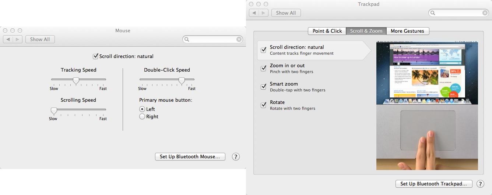
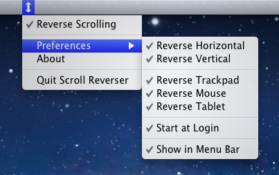

# Mouse e Trackpad com rolagem diferente no Mac OS X

No Mac OS X é possível configurar a direção de rolagem das páginas ou de qualquer coisa que possa ser rolada com a rodinha do mouse, com o trackpad do MacBook ou com o Magic Trackpad da Apple. Por padrão, o sistema utiliza a direção "natural", em que a página sobe quando move-se os dedos para cima e desce quando move-se os dedos para baixo. Utilizando o trackpad neste modo me pareceu bastante confortável e intuitivo, mas o problema começou quando pluguei um mouse: a direção de rolagem da rodinha ficou invertida e difícil de se acostumar, além disso, se você alterar a direção de rolagem do trackpad, também vai alterar a direção de rolagem do mouse! Até parece que é uma falha do sistema, mas o fato é que a Apple pensa em seu Magic Mouse, que possui as mesmas "gestures" que o trackpad do MacBook e Magic Trackpad.

 Configurações de rolagem nativa iguais para mouse e trackpad no Mac

Mas ainda sim, é possível separar as coisas e atribuir configurações diferentes para o trackpad e o mouse (seja ele qual for, Blutooth ou não). Procurando aqui e ali, encontrei um programa chamado "[Scroll Reverser](http://pilotmoon.com/scrollreverser/)" que faz o trabalho de ajustar um opção de rolagem para o trackpad e outra para o mouse. Assim, pode-se plugar o mouse e utilizá-lo sem se preocupar em alterar a configuração de rolagem no Mac OS X:

 Scroll Reverser: permite atribuir uma configuração de rolagem diferente para o Mouse e para o trackpad do Mac (fonte: http://pilotmoon.com/scrollreverser/)

**Referência**
<http://pilotmoon.com/scrollreverser/>
