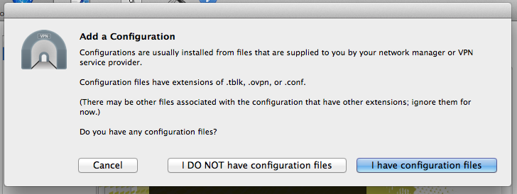
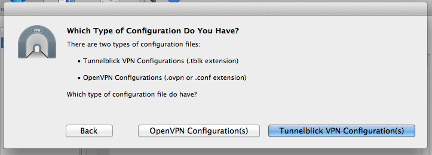
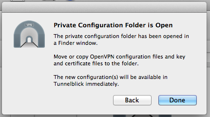
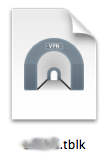
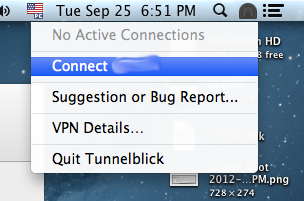
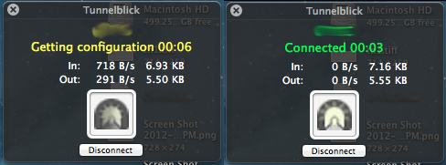
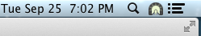

# Utilizando a VPN através do Tunnelblick

O Tunnelblick é um software que utiliza o openvpn e fornece uma interface gráfica simples e funcional para gerenciar conexões VPN. Ele é bastante útil para quem precisa gerenciar várias conexões VPN. No meu caso, tenho apenas uma conexão disponível e por isso utilizava um script fornecido pelo administrador dos sistemas que eu uso. Aliás, por utilizar o Mac OS X, um dos requisitos para que minha conexão VPN funcione é a utilização do Tunnelblick, porque o script fornecido pelo administrador utiliza o openvpn que vem junto com o Tunnelblick. Mas isso não é uma necessidade real, pois pode-se instalar o openvpn através do port do Mac OS (sudo port install openvpn), embora a versão disponível no port seja mais antiga.

Neste artigo, vou mostrar rapidamente como configurar uma conexão VPN através do Tunnelblick para poder aproveitar melhor o que este software tem de bom.

Se você não tem o Tunnelblick, pode baixá-lo neste [link](http://tunnelblick.googlecode.com/files/Tunnelblick_3.3beta21a.dmg) (link direto). Como estou utilizando o OS X Mountain Lion, preciso da versão 3.3 beta 21a do Tunnelblick. Se você utiliza outra versão do Mac OS X, verifique qual versão melhor se adequa ao seu Mac. Instale o Tunnelblick e inicie a configuração da sua VPN.

Depois de instalar o Tunnelblick e abrí-lo pela primeira vez, o configurador irá perguntar se você tem arquivos de configuração ou não. Vou clicar na opção "I have configuration files" (ou Eu Tenho Arquivos de Configuração), pois vou aproveitar os arquivos de configuração do meu script VPN:

 Configurando o Tunnelblick: utilizando arquivos de configuração externos

No passo seguinte, o Tunnelblick perguntará se os arquivos de configuração que você tem já são arquivos do Tunnelblick ou não. No meu caso, não são e eu configurarei minha conexão manualmente, que é o que valida este artigo ;) Se este for também o seu caso, escolha a opção "OpenVPN Configuration(s)" (ou Configurações OpenVPN):

 Tunnelblick: criando uma conexão VPN com as informações prévias da sua conexão

Depois disso, o configurador perguntará qual tipo de configuração você quer criar. Escolha a opção "Open Private Configurations Folder" (ou Abrir Pasta de Configurações Pessoais). Com esta opção, uma pasta do Finder será criada no desktop e é nela em que serão colocadas as informações que temos sobre a VPN:

 Tunnelblick: criando pasta de configurações personalisadas

Nesta etapa, as informações que deverão ser colocadas nesta pasta são as seguintes:

- Um script de configuração openvpn (eg., config.ovpn)
- Uma chave criptografada para a conexão com o servidor (eg., chave.key)
- Um certificado de segurança (eg., certificado.crt)

Lembre-se que estas informações são fornecidas pelo seu administrador de sistemas e que são pessoais e intransferíveis. Portanto, se você não tem estas informações, peça-as ao seu administrador de sistemas.

Depois de ter colocado as informações (arquivos) dentro da pasta que o configurador do Tunnelblick abriu no seu desktop, clique em "Done"(ou Pronto) na janela anterior, renomeie esta mesma pasta para um nome que você queira para a conexão e adicione a extensão ".tblk". Feito isto, terá sido criado um arquivo de configuração VPN do Tunnelblick. Para adicioná-lo ao Tunnelblick, basta dar um duplo clique sobre ele (que na verdade é a pasta em que foram salvas as configurações da VPN):

 Configurações salvas para uso no Tunnelblick (clique duas vezes para adicionar)

Depois disso, basta utiliza o Tunnelblick através do ícone que fica no painel do Mac OS, próximo ao ícone do Spotlight:

 Tunnelblick: menu com as conexões disponíveis

Ao clicar no ícone do Tunnelblick, um menu com as conexões disponíveis será aberto. Para conectar, basta clicar no nome da conexão configurada e realizar a conexão:

 Conectando com o Tunnelblick à esquerda (em amarelo) e à direita, conexão relizada (em verde)

Depois que o Tunnelblick estiver ativo em uma conexão, i ícone do painel fica com uma cor diferente (o que pode ser alterado depois):

 Ícone de atividade do Tunnelblick

Para desconectar, basta clicar no ícone do Tunnelblick e clicar em "Disconnect NOME_CONEXÃO" (ou Desconectar NOME_CONEXÃO).

Vale lembrar que, caso o seu administrador de sistemas requer alguma camada extra de segurança, e esta não estiver contemplada nas configurações do Tunnelblick, será necessário ativá-las antes de se realizar a conexão.

É isso!
