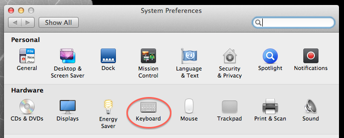
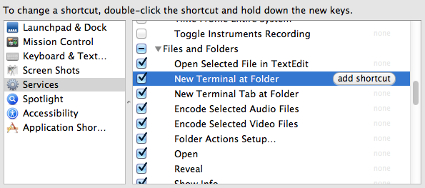
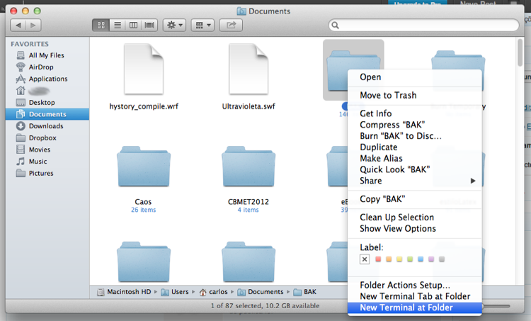

# Abrir o Terminal em uma determinada pasta do Finder

No Nautilus e até mesmo no Windows Explorer é possivel clicar sobre uma pasta e abri-la no terminal, facilitando a vida de quem não vive sem o terminal e precisa de mais agilidade no processamento de arquivos. No Finder do Mac OS X, também é possível fazer a mesma coisa. Caso o menu de contexto do seu Finder não apresente as opções "New Terminal at Folder" e/ou "New Terminal Tab at Folder" (ou Novo Terminal na Pasta), siga os passos abaixo para habilitá-las:

**1) Abra o Painel de Preferências do Mac OS X e clique na opção "Keyboard" (ou Teclado):**
 Preferências do teclado

**2) Nas preferências do teclado, selecione o submenu "Services" (ou Serviços), e role a página até a seção "Files and Folders" (ou Arquivos e Pastas):**
 Opções para Arquivos e Pastas

Se as opções "New Terminal at Folder" e/ou "New Terminal Tab at Folder" (ou Novo Terminal na Pasta) não estiverem marcadas, marque-as para habilitar as novas opções no menu de contexto do Finder. Inclusive, é possível ajustar atalhos do teclado para abrir pastas no Terminal :)

**3) Depois disso, experimente clicar sobre uma pasta qualquer no Finder e selecionar a opção "New Terminal at Folder" (ou Novo Terminal na Pasta):**
 Novas opções no menu de contexto do Finder!

Pronto, agora você pode navegar pelo Finder a abrir suas pastas no Terminal ;)

É isso!
