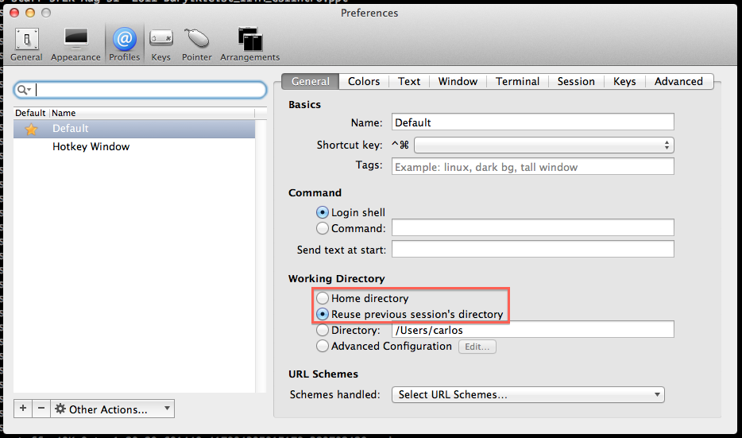

# Abrir aba do iTerm2 no mesmo diretório

O iTerm2 é um excelente substituto do Terminal.app nativo do Mac OS X. Entre várias outras configurações, ele permite dividir o terminal tanto na horizontal quanto na vertical. Mas uma coisa que me incomodava um pouco, era que ele nunca abria uma nova aba no mesmo diretório. Isso pode parecer bobagem, principalmente se ele é capaz de dividir as janelas, mas acredite, isso poupa bastante tempo. Para resolver esse detalhe, basta ajustar um configuração de perfil do próprio iTerm2, quem desabilitada por padrão. Veja na imagem abaixo, para acessar as preferências mostradas, abra o iTerm2, clique em preferências (no painel do Mac OS X, em iTerm2) e depois clique em Profiles - ou Perfis):

 Preferências de perfil do iTerm2: configurando para abrir uma nova aba no mesmo diretório

Basta clicar na opção "Reuse previous session's directory" (ou Reutilizar o diretório da seção anteriror).

É isso!
