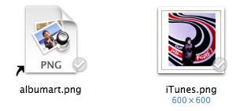
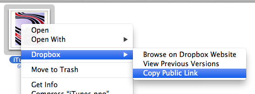
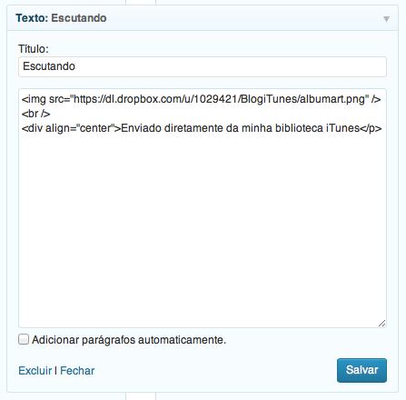
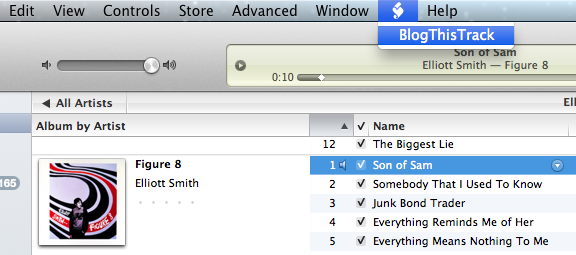
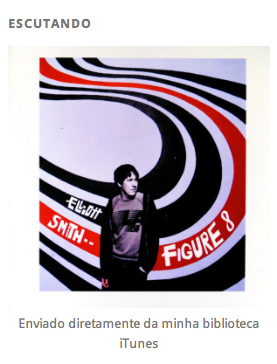

# AppleScript + Dropbox = BlogThisTrack!

Rá!

Eu sempre quis colocar em meu blog os livros que leio, os discos que escuto e as coisas que gosto. Fazer uma resenha sobre um disco ou livro, é praxe e mandatório, mas como mostrar - em tempo real - o que estou escutando?

Sabendo das possibilidades e da linguagem AppleScript, como por exemplo, controlar o iTunes e outros programas através da linha de comando, decidi que colocaria na sidebar do meu blog, uma área com a capa do disco que eu estivesse escutando no iTunes. E é bem simples!

Vamos aos ingredientes:

- Você vai precisar do Dropbox;
- E do iTunes (a princípio é necessário estar no Mac OS X para executar o script).

A ideia é a seguinte: utilizar um link público do dropbox para disponibilizar uma imagem (a capa do album) no seu site/blog. O AppleScript vai servir para recuperar a capa do Album da música que está sendo tocada no iTunes e colocá-la em um pasta pública do Dropbox; o Dropbox, por sua vez, fornece um link público que será colocado no site. Mas como manter o mesmo link se a imagem é atualizada sempre que uma novo Album estiver tocando? Simples: o link (url) aponta para um link simbólico na pasta pública do Dropbox! Nada como uma bela gambiarra :)

O código AppleScript utilizado para recuperar a capa do Album que está tocando no iTunes e copiar para a pasta pública no Dropbox, segue mais abaixo e você deve colocá-lo em:


```
/Users/$USER/Library/iTunes/Scripts
```


Se esta pasta não existir, basta criá-la:


```
$ mkdir -p /Users/$USER/Library/iTunes/Scripts
```


Feito isto, copie o ApplScript "BlogThisTrack" (download mais abaixo) para a pasta:


```
$ cp BlogThisTrack.scpt /Users/$USER/Library/iTunes/Scripts
```


Para fazer tudo funcionar, execute uma vez o AppleScript e, na pasta BlogThisTrack (dentro da pasta pública do Dropbox), crie um link simbólico da imagem do Album recuperada com um nome qualquer, por exemplo:


```
$ cd ~$USER/Dropbox/Public/BlogThisTrack
$ ln -s iTunes.png albumart.png
```


Observe que o link "albumart.png" será atualizado sempre que o script AppleScript for executado.

[](http://craftmind.wordpress.com/2012/11/13/applescript-dropbox-blogthistrack/screen-shot-2012-11-13-at-7-18-01-pm/) Exemplo dos arquivos que ficam dentro da pasta BlogThisTrack, dentro da pasta pública do Dropbpox. Observe que o arquivo albumart.png é um link simbólico para o arquivo de imagem iTunes.png.

Agora uma parte importante, o link: quando se coloca arquivos dentro da pasta Public do Dropbox, é possível obter um link público para qualquer arquivo. Para fazer isto, pelo Finder, dê um clique de "dois dedos" (clique sobre o arquivo utilizando dois dedos, assim você terá acesso ao menu de contexto do Finder) sobre o arquivo, aponte para o menu do Dropbox e selecione a opção "Copy Public Link":

[](http://craftmind.wordpress.com/2012/11/13/applescript-dropbox-blogthistrack/screen-shot-2012-11-13-at-8-09-44-pm/) Obtendo o link público que será usado para linkar a imagem no seu site/blog.

Feito isto, no site, escolha algum lugar (como uma barra lateral) em que será colocada a capa do Album. Na área escolhida, coloque o código:


```

```


Sinta-se livre para incrementar, adicionando uma borda ou mesmo limitando o tamanho da imagem - assim todas as capas poderão ter o mesmo tamanho ;)

Se você estiver no wordpress, e caso você não tenha acesso ao código-fonte do seu site/blog, a melhor forma de fazer a inserção desse código - e é aí que a coisa fica esperta!, é usar a widget de texto.

[](http://craftmind.wordpress.com/2012/11/13/applescript-dropbox-blogthistrack/screen-shot-2012-11-13-at-7-14-16-pm/) Insira uma widget de texto na área que você quiser e insira o código acima.

Insira uma widget de texto na área que você quiser e insira o código acima.

Agora, sempre que você quiser mostrar que Album está escutando no iTunes, basta executar o AppleScript que a capa do Album será atualizada no seu site/blog!

[](http://craftmind.wordpress.com/2012/11/13/applescript-dropbox-blogthistrack/screen-shot-2012-11-13-at-7-08-29-pm/) Executando o AppleScript BlogThisTrack dentro do iTunes.

E e resultado (no seu site/blog):

[](http://craftmind.wordpress.com/2012/11/13/applescript-dropbox-blogthistrack/screen-shot-2012-11-13-at-7-13-39-pm/) Capa do Album no site/blog!

**AppleScript**

Para utilizar este código, não copie este abaixo, mas utilize o link de download a seguir.


```
--BlogThisTrack - script para recuperar a capa de um Album tocando 
  no iTunes e escrever em um arquivo
--AppleScript original em 
  http://www.macosxtips.co.uk/geeklets/collections/
  itunes-seperate-info-mail-infos-/
--Créditos para http://www.macosxtips.co.uk 
  (usuário 
  http://www.macosxtips.co.uk/geeklets/user/profile/csoul/) 
  e craftmind.wordpress.com (usuário 
  http://craftmind.wordpress.com/about/)
--Linguagem: AppleScript (compilador v.2.2.3)
--Data: 13/11/2012

--A variável "myPath" define onde se encontra a pasta 
  "BlogThisTrack" (para o script funcionar, ela deve ser criada 
  manualmete):
set myPath to ((path to home folder) as text) & 
  "Dropbox:Public:BlogThisTrack:"
--A variável "artworkItunes" define o caminho absoluto para 
  o arquivo "iTunes.png" que será escrito ao final do script:
set artworkItunes to POSIX path of myPath & "iTunes.png"
--A variável "defaultPic" define um arquivo intermediário
set defaultPic to POSIX path of myPath & "default.png"

if running of application "iTunes" then
    --Na estrutura abaixo, literalmente é dito ao programa 
      iTunes executar as seguintes ações:
    tell application "iTunes"
        --Define-se a variável "artData" para receber a 
          informação da capa do Album da música que está sendo 
          executada no iTunes:
        set artData to data of artwork 1 of current track
        --Define-se a variável "fileRef" que irá abrir atribuir
          à variável "artworkiTunes" (que aponta para o arquivo
          alvo iTunes.png) a informação da capa do Album:
        set fileRef to (open for access artworkItunes with 
        write permission)
        --Utiliza-se o método try:
        --Caso o iTunes esteja tocando alguma música e esta
          possui uma capa de Album definida, a informação da 
          capa do Album será escrita na variável "fileRef":
        try
            write artData to fileRef starting at 0
            close access fileRef
            --Caso alguma música não esteja tocando ou se
              não houver capa de Album disponível, uma mensagem
              de erro padrão será mostrada:
            on error errorMsg
            --Novamente usa-se o método try, agora para fechar 
              o arquivo iTunes.png:
            try
                close access fileRef
            end try
            --Caso algum erro de escrita ocorra (devida a um disco 
              cheio, por exemplo):
            error errorMsg
        end try
    end tell
else
    --Utiliza-se o programa Image Events (pode-se utilizá-lo 
      em outros scripts para a manipulação de imagens):
    tell application "Image Events"
        set defaultData to open defaultPic
        --Salva o arquivo final na variável principal 
          "artworkiTunes":
        save defaultData as PNG in artworkItunes with replace
        --Fecha o arquivo final:
        close defaultData
    end tell
end if
```


**Download**

Aqui: [BlogThisTrack](https://dl.dropbox.com/u/1029421/BlogThisTrack/BlogThisTrack-v0.1.scpt)!

**Dicas**

- Como o "BlogThisTrack" utiliza o iTunes, tire proveito disso: utilize-o para manter as capas dos seus Albuns atualizadas, assim não correrá o risco de não ter nenhuma imagem para mostrar;
- Há outros AppleScripts que podem ser utilizados para ajudar a manter a sua biblioteca de músicas organizada e atualizada, veja [aqui](http://dougscripts.com/itunes/).

**Observações**

- Este método depende do Dropbox. Para que a atualização das capas do Album no seu site/blog funcione, é necessário que o Dropbox esteja funcionando.

**Referências**

- <http://www.macosxtips.co.uk/geeklets/collections/itunes-seperate-info-mail-infos-/>
