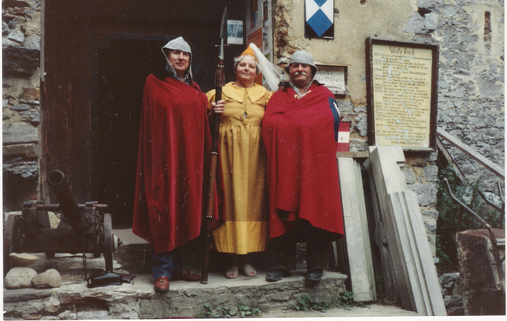
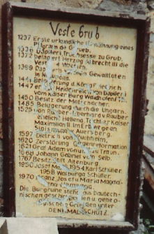

# Grüße aus Österreich

 Friedrich, Margaretha e Franz (Foto, arquivo pessoal - cópia e/ou reprodução não permitida).

Nesta foto estão meu avô Friedrich, minha avó Margaretha e meu tio-avô Franz (irmão da minha avó). Eles estão em frente à entrada de um castelo chamado Grub, que fica na cidade austríaca de Horn. Meu avô - de origem romena, e minha avó - de origem tcheca, conheceram-se na Áustria onde viveram desde a infância até o final segunda guerra mundial e depois migraram para o Brasil nos anos 1950, onde fixaram-se. Muito embora estivessem longe dos amigos e da terra natal, as ligações com alguns dos familiares e amigos mais próximos, bem como a influência dos costumes e cultura austríacos, sempre foram muito fortes em nossa família. No final dos anos 80, meus avós foram passar férias na Áustria e aproveitaram para visitar meu tio avô, Franz.

Meu tio avô adquiriu o Grub já em ruínas por volta dos anos 1970. O castelo data de aproximadamente do século XII (detalhe da foto a seguir). A história conta que o castelo passou pelos domínios de diversas famílias nobres até ser praticamente destruído no século XVII.

 Detalhe: cronologia do castelo Grub em Horn, Áustria.

A idéia de Franz e de sua esposa, Maria Magdalena - apaixonados pela história, era restaurar o Grub e transformá-lo em ponto turístico. Assim o fizeram, Franz e Maria, enquanto foi possível. Meu tio avô morreu em 2006 (Maria já havia morrido) e minha avó se foi em 2011.

Todos de nossa pequena família brasileira, sempre nos admiramos desta história, apesar de parecer um sonho muito distante de nossa realidade. É uma pena que os parentes do lado austríaco não se interessem muito por esta história, por acreditarem que o esforço e paixão de Franz e Maria, na época, fosse perda de tempo e dinheiro. É um grande legado, exemplo e uma herança cultural e histórica que devem ser preservados! Hoje já não sabemos qual é o estado atual do castelo e o que ocorrerá a ele, apesar de ser um patrimônio cultural austríaco.

Em 2011 tive a oportunidade de estar em Viena, por um período de tempo muito curto. Infelizmente não tive a oportunidade de conhecer o Grub (que fica em outra cidade), mas valeu muito a pena mirar o rosto das pessoas e enxergar o olhar dos meus avós!

Os fatos podem não ser muito precisos, principalmente porque compreende uma parte muito comprida da história, mas apesar de as pessoas não acreditarem muito, esta sempre foi uma história de família muito interessante!

Na internet, há uma página feita por um visitante do Grub, com algumas informações e alguns fatos históricos sobre o castelo:

<http://www.castles.nl/eur/at/gru/gru.html>
