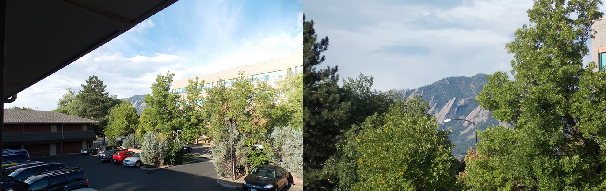
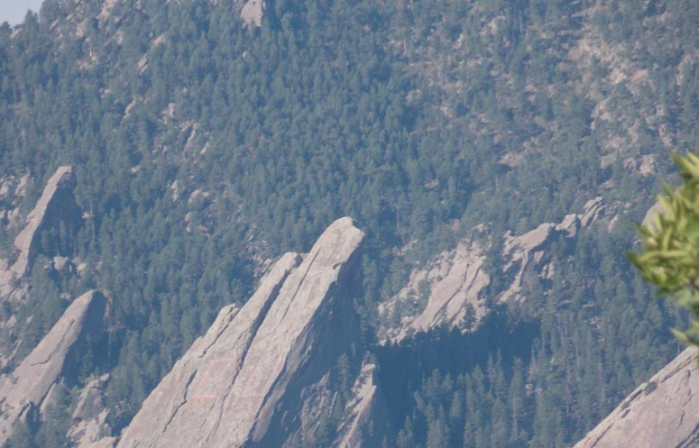

# ICU

 Montanhas inocentes de Boulder/CO (EUA).

Tirei estas fotografias enquanto testava um nova câmera fotográfica (uma Nikon Coolpix L810). Brincando com o zoom da câmera, fui aproximando e focando as rochas. As rochas na foto ficam em Boulder/CO (EUA) e olhando as fotografias, observei que em um dos picos está a inscrição "ICU". Logo que vi, pensei: Isso é muito curioso... somente com um zoom realmente alto (o zoom da câmera é alto, 26X) era possível ver a inscrição:

 ICU, dá pra ver?

Então, ou isso poderia ser uma brincadeira de alguém que escreveu aquilo na rocha fazendo o observador pensar que alguém na montanha também poderia observá-lo, afinal as letras "ICU" podem ser interpretadas como "I see you" ou... aquilo é apenas uma inscrição.

Na dúvida, ficam registrados a curiosidade e a eventualidade do fato!
