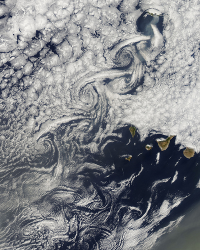

# Vórtices de Von Kármán

 Nuvens em vórtice alinhadas.

Essas nuvens frequentemente podem ser observadas sobre o oceano, principalmente sobre ilhas. Elas ocorrem quando o vento espalha as nuvens estratiformes e este interage com a topografia da(s) ilha(s) possibilitando a formação dos vórtices. Tais vórtices são também denominados de Vórtices de von Kármán. Neste caso, estas nuvens foram observadas sobre as Ilhas Canárias (do arquipélago espanhol) em 14 de agosto de 2010, pelo satélite Aqua/NASA.

Original em <http://www.flickr.com/photos/gsfc/4897631523/>
