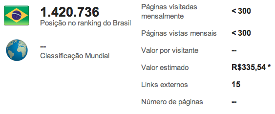

# Quanto vale o seu site/blog? #2

Em junho de 2012 fiz um [post](../../../2012/06/20/quanto-vale-o-seu-siteblog-wp-1680.md) aqui no blog apresentando quando valia o meu blog, o destemido "Aleph Zero". Naquela época, meu blog valia R$ 183,05. Por curiosidade, esses dias entrei novamente no [URL Espião](http://urlespiao.com.br) (antigo URL Pulso) pra ver se esse valor havia mudado. Para minha surpresa, meu blog valorizou (quaaaaaase) 100%! Agora ele vale incríveis R$ 335,54!

 Valor do Aleph Zero em fevereiro de 2013.

Para um blog de notas mentais, está mais do que ótimo :)
