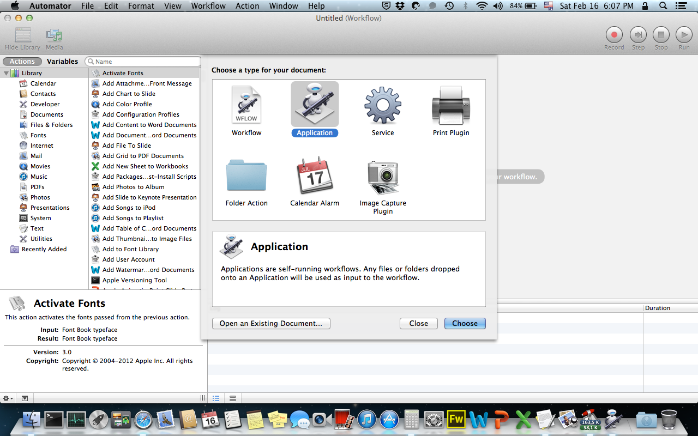
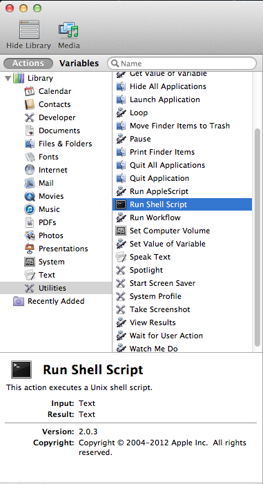
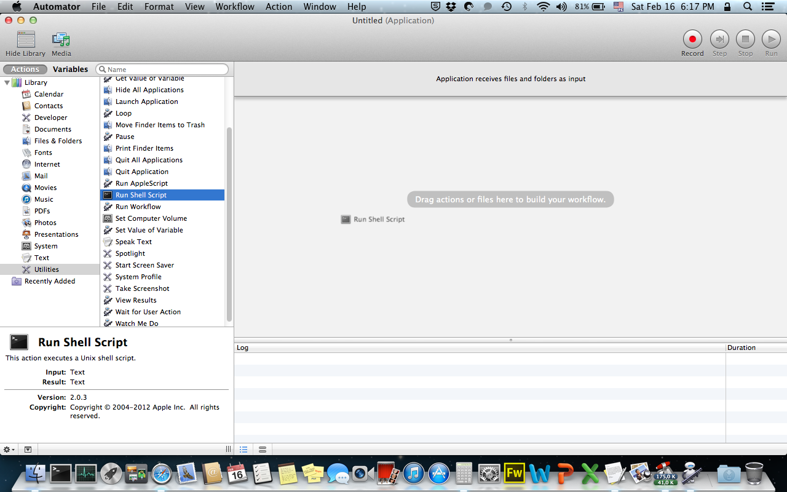
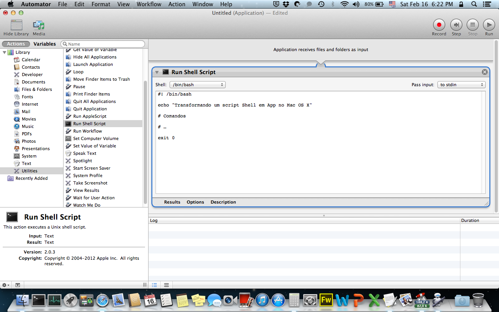
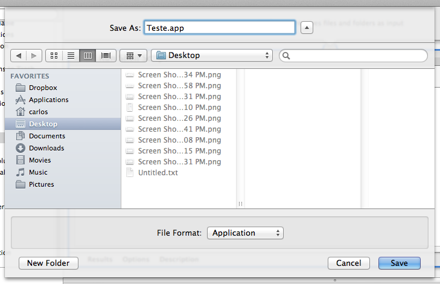

# Transformando Scripts em Apps no Mac OS X

Scripts em geral são úteis na automatização de tarefas, na organização de processos e tarefas de longa duração. No Mac OS X, existe a possibilidade de se transformar um script em um aplicativo (.app), que pode ser utilizado na inicialização do sistema, logo após o login do usuário. Esta tarefa pode ser realizada utilizando-se o Automator, um programa embutido do Mac OS X que auxilia o usuário a automatizar tarefas, sem a necessidade de se programar um script. Neste post, entretanto, mostrarei como utilizar o Automator para transformar um script em um "App".

Preparando o Script

Em primeiro lugar, é necessário preparar o script em questão. Se o script recebe argumentos para a sua execução, por exemplo, se ele é executado da seguinte forma:


```
$ ./script.sh argumento
```


então, é mais fácil simplificar um pouco o script, se possível, para que seja eliminado o argumento e o script seja executado sem ele. Neste caso, o argumento de entrada - caso seja apenas um tipo único, deve ser "hadrwired" dentro do código. Isso não é interessante em um script, mas para transformá-lo em um "App", é mais fácil :)

Quando o script estiver pronto, sendo possível executá-lo sem a necessidade de argumentos, pode-se abrir o Automator do Mac OS X para preparar o App.

Preparando o App

Abra o Automator (ele fica dentro da pasta Utilities, que fica dentro da pasta Applications). Na tela inicial, selecione "Application":

[](../../../../assets/wordpress/2013/02/screen-shot-2013-02-16-at-6-07-31-pm.png) Selecionando o tipo Aplicativo no Automator

A seguir, selecione a opção "Utilities" (ou Utilitários) e depois a opção "Run Shell Script" (ou Executar Script Shell). Estas opções ficam no painel esquerdo do Automator:

[](../../../../assets/wordpress/2013/02/screen-shot-2013-02-16-at-6-13-10-pm.png) Selecionando a opção a ação "Run Shell Script" no Automator.

Depois, clique e arraste a ação "Run Shell Script" (ou Executar Script Shell) para o painel direito do Automator:

[](../../../../assets/wordpress/2013/02/screen-shot-2013-02-16-at-6-17-26-pm.png) Arrastando a ação "Run Shell Script" para o painel direito do Automator.

No painel esquerdo do Automator, será aberta uma janela na qual deverá ser digitado o script:

[](../../../../assets/wordpress/2013/02/screen-shot-2013-02-16-at-6-22-08-pm.png) Digite o script na janela posicionada no painel direito do Automator.

Depois disso, basta clicar na barra de menus e salvar o "App":

[](../../../../assets/wordpress/2013/02/screen-shot-2013-02-16-at-6-25-35-pm.png) Salvando o Script em App no Automator.

Depois de salvo, o App se comporta como qualquer outro no Mac OS X, sendo possível - inclusive, adicioná-lo na inicialização do Mac OS X!
