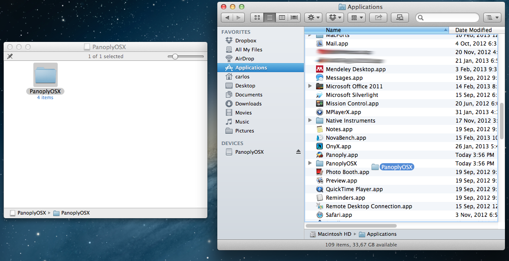
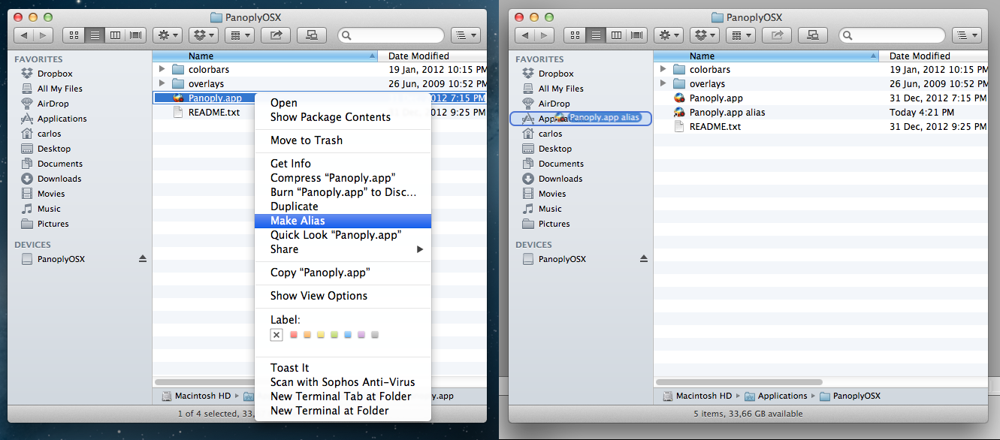
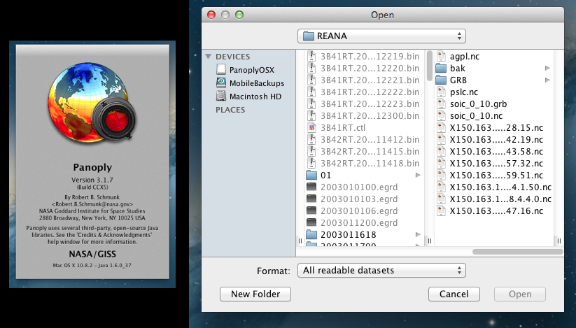
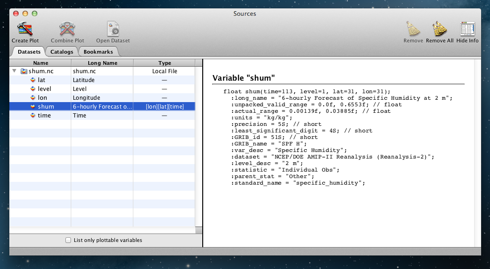
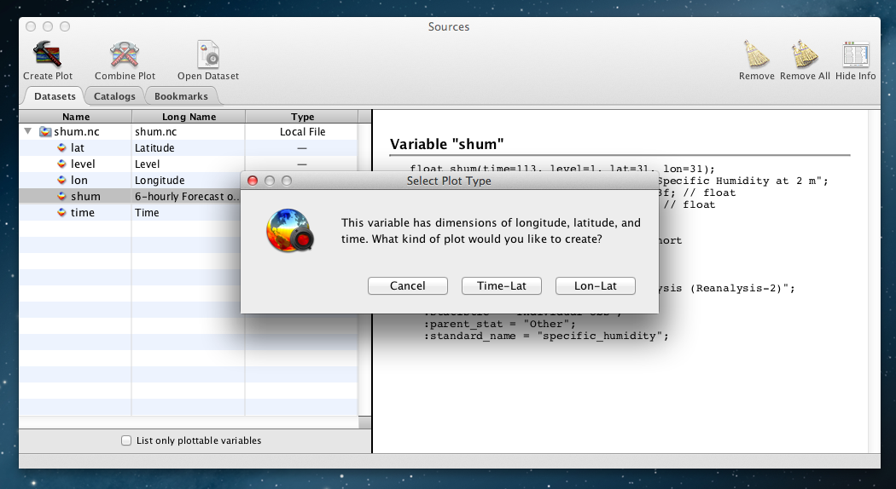
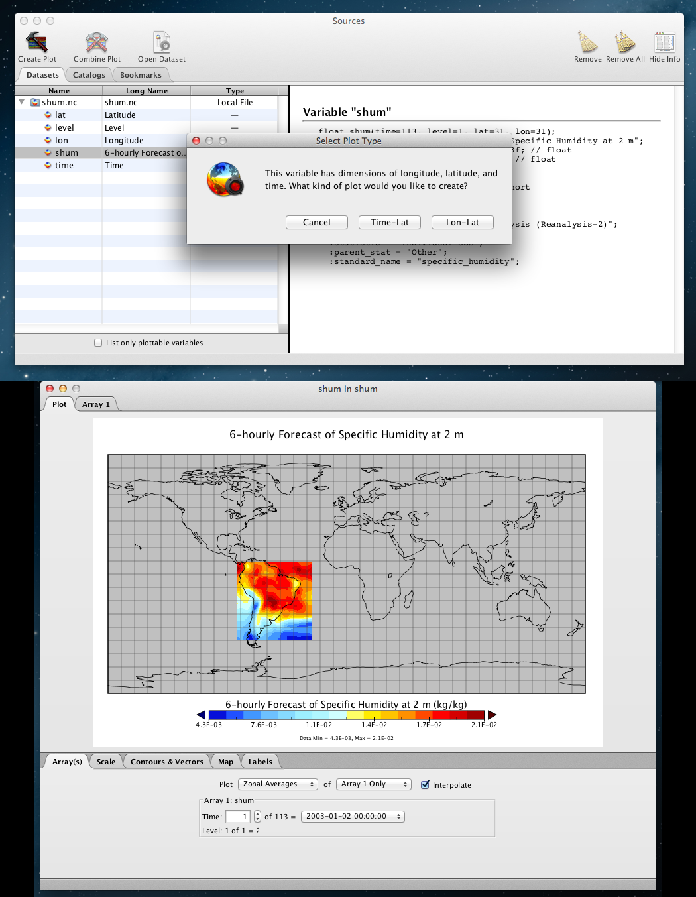

# Panoply: Software de Visualização de Dados em Ponto de Grade

O [Panoply](http://www.giss.nasa.gov/tools/panoply/) (pronuncia-se PA.NO.PLI) é um poderoso e completo software de visualização de dados geofísicos (meteorológicos e oceanográficos) em ponto de grade, capaz de ler e plotar dados nos formatos netCDF, HDF e GRIB desenvolvido pela NASA. Assim como outros softwares do gênero (GrADS, FERRET, NCVIEW, Metview e outros), ele decodifica as informações dos dados e, por meio de uma lista, permite o usuário selecionar as variáveis que quer visualizar e as plota na projeção desejada. Diferentemente do GrADS, por exemplo, ele possui uma interface gráfica simples, sendo - neste aspecto, semelhante ao Metview. Neste post, vou mostrar como fazer a instalação do Panoply no Mac OS X e um exemplo de uso.

**Obtendo o pacote de instalação do Panoply**

O pacote de instalação para Mac do Panoply pode ser obtido na página do projeto:

- <http://www.giss.nasa.gov/tools/panoply/download_mac.html> (link direto para o pacote [aqui](http://www.giss.nasa.gov/tools/panoply/PanoplyOSX.dmg))

**Instalação do Panoply no Mac OS X**

Abra o arquivo .dmg baixado no seu computador e arraste a pasta "PanoplyOSX" para a pasta Applications (ou qualquer outra pasta que você queira):

 Instalação do Panoply no Mac OS X.

Depois disso, você terá uma cópia do Panoply instalada no seu Mac OS X e pronta para uso. Mas antes de abrir o programa pela promeira vez, vamos criar uma aliase do app principal para fora da pasta PanoplyOSX - assim mantém-se as coisas mais organizadas e no seu devido lugar (isso pode evitar que o programa principal deixe de encontrar os arquivos auxiliares de mapas, projeções etc):

 Criando uma aliase do programa principal (Panoply.app) e colocando-o na pasta Applications.

**Utilizando o Panoply**

Para abrir e utilizar o Panoply, é trivial: basta dar um duplo clique no executável principal (abra a aliase que você criou), ou pesquise por ele no Spotlight do Mac OS X, ou mesmo no Launchpad.

Quando se abre o Panoply, uma splash screen é mostrada e, logo em seguida, é perguntado ao usuário qual arquivo abrir:

 Splash screen e file browser do Panoply.

No exemplo que vou mostrar, vou abrir um arquivo netCDF de umidade específica da Reanálise 2 do NCEP, recortado para o domínio da América do Sul:

 Abrindo um arquivo netCDF no Panoply.

Observe na figura acima, que no lado esquerdo da interface gráfica do Panoply, é mostrado o conteúdo do arquivo. As camadas contidas nesse arquivo são: latitudes, níveis, longitudes, variável(is) e tempo. Já no lado direito, são mostradas as informações mais detalhadas sobre o conteúdo do arquivo netCDF, tal como se estivéssemos utilizando o comando ncdump.

Para plotar o campo de umidade específica desse arquivo, basta selecionar (clicar sobre) o nome da variável - neste caso, "shum" (de specific humidity) e clicar no botão "Create Plot". Fazendo-se isso, será perguntado ao usuário qual o tipo de plot se deseja criar:  Tempo X Latitude ou Latitude X Longitude. A escolha aqui (para efeito de ilustração, foi Lat/Lon, assim podemos ver um campo bidimensional da variável):

 Criando um plot espacial no Panoply.

Na figura acima, a imagem na parte de baixo é a janela de plotagem do Panoply. Nela, através das diversas abas, é possível ajustar os parâmetros de plotagem. Pode-se modificar, entre outros, as cores, a posição da barra de legendas, a projeção, os títulos dos eixos e legenda, a data do campo plotado, a escala, incluir linhas de contorno etc. Inclusive, dá para criar animações!

Depois de instalar o Panoply, plote um campo espacial, modifique os parâmetros, faça um Diagrama de Hovmöller (para isso, escolha a opção Latitude X Tempo). O programa é bastante interessante e rápido, principalmente porque não é necessário programar suas ações!
