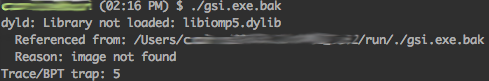

# Runtime error: &quot;dyld: Library not loaded: libiomp5.dylib&quot;

Esses dias estava tentando executar uma aplicação compilada com o OpenMPI no OS X Mountain Lion quando me deparo com a seguinte mensagem de runtime:



Essa mensagem indica que, embora o executável tenha sido lincado com a biblioteca dinâmica "libiomp5.dylib", o executável não conseguiu encontrar a biblioteca para a sua execução. Procurando na internet, encontrei uma forma de contornar este problema. Há um programa de linha de comando chamado "install_name_tool" (que provavelmente faz parte do pacote binutils) e que permite incluir o PATH para a lib libomp5.dylib diretamente no executável gerado. Para resolver o meu problema, utilizei o comando da seguinte forma:


```
 $ install_name_tool -change libiomp5.dylib /opt/intel/composer_xe_2013/lib/libiomp5.dylib ./gsi.exe
```


Observe que no meu caso, a lib libiomp5.dylib está em /opt/intel/composer_xe_2013/lib.

**Referência:**

- <http://software.intel.com/en-us/articles/linking-and-redistributing-intel-dynamic-libaries-on-mac-os-x>
